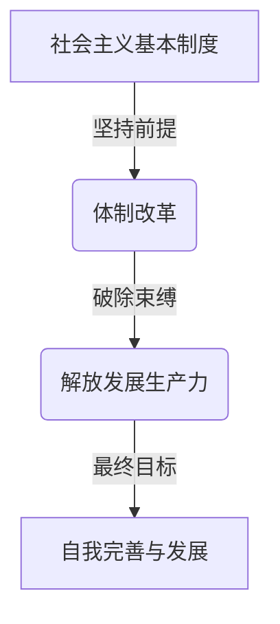

# 改革是社会主义制度的自我完善和发展

> [!IMPORTANT]
> 核心结论：==改革是社会主义制度的自我完善和发展==，而不是对社会主义制度的否定或改弦易辙。

## 它是什么

思考一个问题：1978 年十一届三中全会决定把全党工作重点转移到社会主义现代化建设上来，这是否意味着我们要抛弃之前建立的社会主义基本制度？

答案是否定的。正如邓小平在十二大开幕词中所指出的：“把马克思主义的普遍真理同我国的具体实际结合起来，走自己的道路，建设有中国特色的社会主义”。改革的对象不是社会主义根本制度，而是生产关系和上层建筑中不适应生产力发展的具体体制机制。它是社会主义发展的内在要求，是决定中国命运的重大决策。

## 为什么需要

从历史脉络看，1956 年底我国建立起社会主义基本制度，为当代中国发展进步奠定了根本政治前提和制度基础。但在探索过程中，由于缺乏经验，脱离实际、急于求成的情绪滋长，导致了“大跃进”以及长达十年的“文化大革命”内乱，使国民经济埋下严重危机。

中共八大早已正确指出，国内主要矛盾是人民对于经济文化迅速发展的需要同当前经济文化不能满足人民需要的状况之间的矛盾。“文革”结束后，国家在徘徊中前进，受长期形成的“左”的思想束缚，旧体制严重阻碍了社会进步。因此，必须通过改革来扫除体制障碍，这是历史给出的唯一正确答案。

## 怎么做与核心原则

改革在实践中始终围绕党在社会主义初级阶段的基本路线展开，即“一个中心两个基本点”：以经济建设为中心，坚持四项基本原则，坚持改革开放。

- **经济体制改革**：全面深化经济体制改革的核心问题是处理好政府和市场的关系。
- **文化与社会建设**：发展中国特色社会主义文化，坚守中华文化立场，推动物质文明和精神文明协调发展。
- **理论指导**：十三大阐述了社会主义初级阶段理论，明确至少需要上百年时间，为改革提供了科学的阶段性定位。

## 概念辨析与常见坑

考试中极易将“改革”与“革命”、“改旗易帜”混淆。请牢记以下对比：

| 比较维度 | 改革（自我完善） | 改变社会制度的“革命” |
| :--- | :--- | :--- |
| **性质** | 社会主义制度内的体制调整 | 推翻旧制度建立新制度 |
| **对象** | 不适应生产力发展的具体环节 | 根本政治与经济制度 |
| **目的** | 解放和发展生产力 | 政权更迭与阶级替代 |

> [!WARNING]
> 常见陷阱：题目若表述“改革是对社会主义基本制度的否定”，该说法绝对错误。东欧剧变、苏联解体只是苏联模式的失败，而不是社会主义本身的失败。我国的改革始终坚持公有制的主体地位，科学社会主义基本原则不能丢。

> [!TIP]
> 记忆口诀：基本制度不动摇，体制机制动手术；一个中心搞建设，自我完善向前走。

## 真题验证

结合复习提纲中的经典考题进行实战推演：

**题目**：（ ）是社会主义发展的内在要求。
A. 沿袭  B. 复古  C. 坚守  D. 改革

**解析**：
1. 审题眼：“内在要求”指向的是事物向前发展的动力机制。
2. 排错项：“沿袭”“复古”违背了人类社会由低级到高级发展的规律；单纯的“坚守”若不伴随创新，就会陷入僵化（如“文革”后的徘徊期）。
3. 定正解：只有“改革”能不断破除束缚，实现制度的自我完善和发展。

**答案**：D
