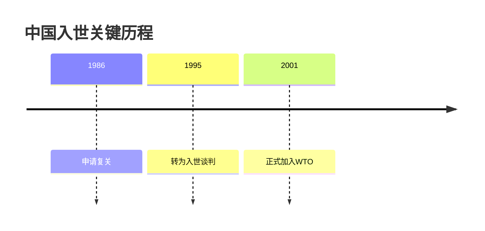

# 迈向新世纪：中国加入世界贸易组织（WTO）的历程与影响

## 什么是世界贸易组织

在复习改革开放史时，我们常把“入世”当作一个孤立的时间节点。但你是否想过，中国为何要历经15年艰难谈判，非要加入这个组织？这背后不仅是经济账，更是国家战略的主动抉择。

> [!IMPORTANT]
> 世界贸易组织（WTO）是==独立于联合国的永久性国际组织==，其核心宗旨是建立多边贸易体系、稳定对外贸易发展及维护经济发展稳定，绝非提高贸易壁垒。

## 为什么需要加入WTO

2001年我国GDP世界排名仅为第6位，面对全球化浪潮，封闭只会导致落后。加入WTO表明中国==主动融入世界经济、履行更多国际义务的基本态度==。这既是倒逼国内体制改革的外部动力，也是获取国际市场准入、参与规则制定的必由之路。

| 对比维度 | 关贸总协定(GATT) | 世界贸易组织(WTO) |
| :--- | :--- | :--- |
| 法律地位 | 临时性多边协定 | 永久性国际组织 |
| 管辖范围 | 仅货物贸易 | 货物、服务、知识产权 |
| 争端解决 | 协商一致(易被否决) | 强制管辖(反向一致) |

## 核心考点与避坑指南

做题时最容易混淆的是WTO的宗旨与性质。请记住：WTO致力于==降低而非提高贸易壁垒==。若选项中出现“提高关税”“限制进口”等表述，直接排除。

> [!WARNING]
> 常见误区：认为WTO是联合国下属机构。实际上它是独立于联合国的永久性国际组织，二者仅有合作关系而无隶属关系。

[!TIP]
> 解题口诀：WTO三要素——“独立永久、多边开放、降壁促稳”。判断题见“主动融入”选√，见“附属联合国”选×。

## 真题实战解析

以经典选择题为例：“世界贸易组织的宗旨不包括（ ）”。A项“稳定对外贸易发展”、B项“建立多边贸易体系”、C项“维护经济发展稳定”均符合WTO促进自由贸易的核心职能。而D项“提高贸易壁垒”与WTO推动贸易自由化的根本目标背道而驰，故答案为D。此题精准对应了“宗旨不包括提高壁垒”这一高频考点，验证了上述辨析逻辑的正确性。

> [!NOTE]
> 延伸思考：入世并非终点而是起点。从GDP世界第六到如今稳居第二，正是当年主动拥抱规则、深化改革的红利释放。理解这段历史，需将“入世”置于中国特色社会主义探索的宏大叙事中把握。
