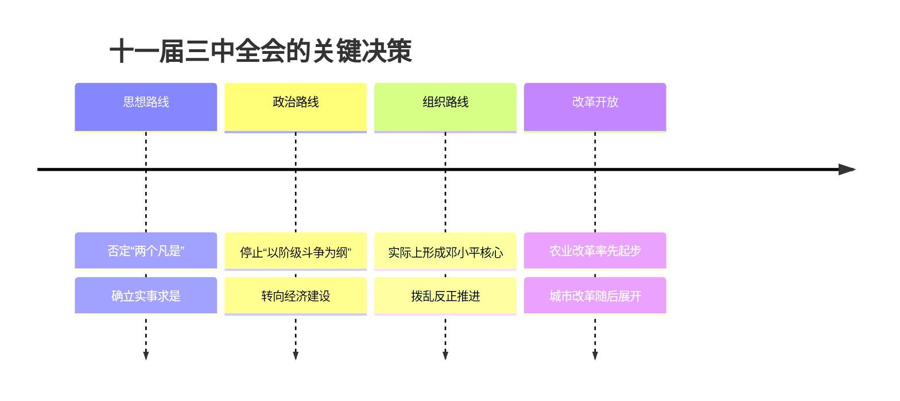

# 党的十一届三中全会：伟大的历史转折里程碑

## 党的十一届三中全会：伟大的历史转折里程碑

先回到 1978 年的场景：十年“文革”刚结束，经济接近崩溃边缘，“两个凡是”还在束缚人们的思想。如果继续“以阶级斗争为纲”，国家就难以走出困境。那么，**破局的第一步应该落在哪里？**

答案是：先重新回答“往哪儿走”，再解决“怎么走”。前者靠思想路线，后者靠工作重心。党的十一届三中全会正是在这两个根本问题上完成了转向。

### 为什么需要这次全会

“文革”结束后，党内外普遍要求纠正“左”的错误，但徘徊局面持续了两年。原因并不只在具体政策，而在于判断是非的标准出了问题。不打破教条主义，不恢复实践标准，改革就没有思想前提。

> [!IMPORTANT]
> 全会的历史功绩可以概括为三条：==重新确立解放思想、实事求是的思想路线==；==作出把工作重点转移到社会主义现代化建设上来、实行改革开放的决策==；==实际上形成了以邓小平为核心的党的第二代中央领导集体==。

### 全会完成了什么

全会之前，中央工作会议开了 36 天。1978 年 12 月 13 日，邓小平在闭幕会上发表《解放思想，实事求是，团结一致向前看》的讲话。这篇讲话实际上成为三中全会的主题报告。如果考试中出现“中央工作会议闭幕式 + 邓小平 + 正确选项”，对应的就是这篇讲话，而不是《坚持四项基本原则》或后来的《关于建国以来党的若干历史问题的决议》。

全会最直接的政治决断是：==停止使用“以阶级斗争为纲”的口号==，把党和国家的工作重点转移到经济建设上来。这意味着政治路线的根本转变。此前“抓革命”是第一位的，此后“搞建设”才是中心任务。

### 相近概念辨析：不要串会

| 会议 | 核心内容 |
|---|---|
| 党的十一届三中全会（1978.12） | 转折：经济建设为中心，改革开放起步 |
| 党的十一届六中全会（1981.6） | 通过《关于建国以来党的若干历史问题的决议》 |
| 党的十二大（1982.9） | 提出“建设有中国特色的社会主义” |
| 党的十四大（1992.10） | 确立社会主义市场经济体制改革目标 |

> [!WARNING]
> 最容易混淆的是三中全会与六中全会。《关于建国以来党的若干历史问题的决议》是==六中全会==通过的，不是三中全会。它解决的是科学评价毛泽东和毛泽东思想的问题，属于“拨乱反正”的完成阶段；三中全会解决的是“转向哪里”和“以什么为中心”的问题。

另一个配套概念是**四项基本原则**。邓小平在 1979 年理论务虚会上提出，后来被六中全会称为全党团结的共同政治基础。它的内容可以简记为：==社会主义道路、人民民主专政、党的领导、马列主义毛泽东思想==。考试中如果题目问“共同政治基础”，选项里出现“改善民生”“密切联系群众”，都不对。

### 一个算对了的例子

> 选择：党的十一届三中全会决定将全党全国的工作重点转移到社会主义现代化建设上来，以（ ）建设为中心。  
> 答案：**经济建设**。

解析思路：三中全会的政治路线转变，核心判断词是“经济”。A“政治建设”恰好是全会要否定的“以阶级斗争为纲”的旧逻辑；B“制度建设”、C“文化建设”都不是全会的中心表述。

> [!TIP]
> 记忆口诀：三中“转”——思想转（实事求是）、重心转（经济建设）、道路转（改革开放）。六中“评”——评价历史、确立毛泽东思想地位。做到“三中转、六中评”，选择题基本不会串。

### 可以迁移到新题的线索

如果题目出现“解放思想，实事求是，团结一致向前看”“以经济建设为中心”“改革开放起步”“实际上形成第二代中央领导集体”中的任意两个，基本可以锁定**党的十一届三中全会**。如果出现“历史决议”“毛泽东的历史地位”“共同政治基础”，则分别优先考虑**十一届六中全会**与**四项基本原则**。
