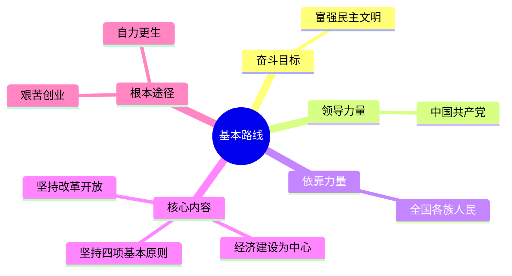

# 中共十三大提出社会主义初级阶段理论和党的基本路线

## 它是什么与为什么需要

1987年召开的中共十三大，其核心贡献在于系统阐述了==社会主义初级阶段理论==并确立了==党的基本路线==。在此之前，我们对“什么是社会主义、怎样建设社会主义”的认识尚不够清晰，容易出现超越阶段的急躁冒进或落后于时代的保守倾向。

> [!IMPORTANT]
> 十三大的主题是“社会主义初级阶段的理论及其基本路线”，而非确立市场经济体制（十四大）或提出“建设有中国特色社会主义”命题（十二大）。

这一理论明确指出：我国正处于并将长期处于社会主义初级阶段。这并非泛指任何国家进入社会主义都会经历的起始阶段，而是==特指我国在生产力落后、商品经济不发达条件下建设社会主义必然要经历的特定阶段==。时间跨度从1956年三大改造完成到社会主义现代化基本实现，至少需要上百年。

## 怎么做：一个中心与两个基本点

基于初级阶段“人民日益增长的物质文化需要同落后的社会生产之间的矛盾”这一主要矛盾，大会提出了党在社会主义初级阶段的基本路线。我们可以将其结构拆解如下：

[!TIP]
记忆口诀：“一三三一”。即==一个中心==（经济建设）、==两个基本点==（四项基本原则、改革开放）、==三位一体==目标（富强、民主、文明）、==一条根本途径==（自力更生、艰苦创业）。注意此时的目标尚未包含“和谐”与“美丽”。

## 易混概念辨析与避坑指南

复习时最容易将十三大与其他重要会议混淆，需重点区分：

| 会议 | 核心关键词 | 备注 |
| :--- | :--- | :--- |
| ==中共十二大== | 建设有中国特色社会主义 | 首次提出该命题 |
| ==中共十三大== | 初级阶段理论、基本路线 | 系统阐述“一个中心、两个基本点” |
| ==中共十四大== | 社会主义市场经济体制 | 明确改革目标模式 |
| ==中共十五大== | 邓小平理论写入党章 | 确立为指导思想 |

> [!WARNING]
> 做题时看到“市场经济”选十四大；看到“初级阶段理论体系化”或“基本路线完整表述”选十三大。题干若问“主题”，必须精准对应报告标题核心词，不可凭印象模糊选择。

## 真题实战验证

以经典选择题为例：

> **题干**：党的十三大的主题是（）。
> A. 确立社会主义市场经济体制改革目标
> B. 推进政治文明建设和先进文化建设
> C. 社会主义初级阶段的理论及其基本路线
> D. “建设有中国特色社会主义”

**解析逻辑**：首先排除A（属于十四大）和D（属于十二大）。B项涉及的政治文明与先进文化建设是后续会议逐步完善的议题。C项准确概括了十三大报告的两大支柱：理论基石（初级阶段）与实践纲领（基本路线）。因此正确答案为==C==。

[!CAUTION]
切勿将“社会主义初级阶段”等同于“新民主主义社会”。前者是社会主义制度已经建立后的特定发展阶段，后者则是向社会主义过渡的时期，两者在社会性质、主要矛盾和任务上均有本质区别。
