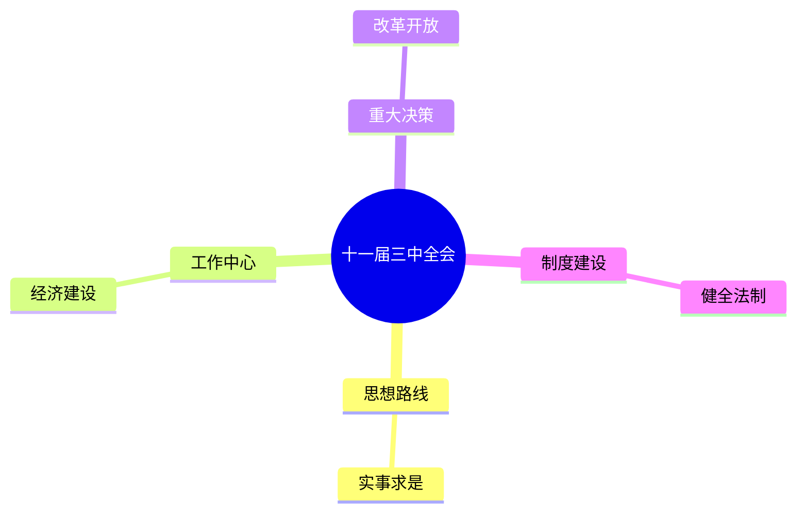
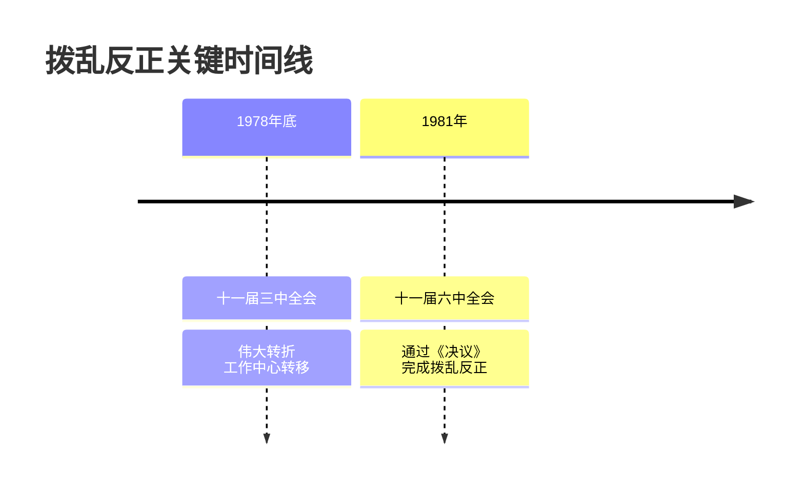

# 党的十一届三中全会实现历史性的伟大转折

在经历了“文化大革命”的严重挫折后，中国社会主义事业将走向何方？1978年12月召开的==党的十一届三中全会==给出了历史性的回答。它实现了新中国成立以来党的历史上具有深远意义的伟大转折，开启了改革开放和社会主义现代化建设新时期。

## 它是什么与为什么需要

> [!IMPORTANT]
> 核心定位：十一届三中全会是党和国家历史上的==伟大转折==，标志着中国进入改革开放和社会主义现代化建设的新时期。

“文革”结束后，国家百废待兴，“两个凡是”的错误方针依然束缚着人们的思想。如果不从思想路线和政治路线上彻底拨乱反正，社会主义事业就无法继续前进。因此，必须召开一次会议来纠正错误、指明方向。

全会作出了四项重大决策：

- ==重新确立了马克思主义的实事求是的思想路线==
- 决定将全党全国的工作重点转移到社会主义现代化建设上来，以**经济建设**为中心
- 提出了实行**改革开放**的历史性决策
- 提出了**健全法制**的任务

## 怎么做：拨乱反正的两步走

思想路线确立后，如何彻底清算历史错误？这需要分阶段完成。全会开启了拨乱反正的进程，但指导思想上拨乱反正任务的最终完成，是在后续的会议上实现的。

## 相近概念的区别与常见坑

考试中极易将“十一届三中全会”与“十一届六中全会”混淆。请记住：==三中全会是“转折起点”，六中全会是“总结定论”==。

| 对比维度 | 十一届三中全会（1978） | 十一届六中全会（1981） |
| :--- | :--- | :--- |
| **核心贡献** | 实现伟大转折，开启改革开放 | 审议通过《关于建国以来党的若干历史问题的决议》 |
| **思想路线** | 重新确立实事求是 | 肯定毛泽东历史地位和毛泽东思想 |
| **对“文革”态度** | 开始拨乱反正 | ==彻底否定“文化大革命”==及“无产阶级专政下继续革命”理论 |
| **历史地位** | 新时期开端 | 标志着指导思想上拨乱反正历史任务完成 |

> [!CAUTION]
> 高危误区：看到“通过《关于建国以来党的若干历史问题的决议》”或“彻底否定‘文化大革命’”就选十一届三中全会，这是错的！这些均属于==十一届六中全会==的内容。

> [!WARNING]
> 易错坑：判断题说“十一届三中全会决定将工作重点转移到现代化建设上来，并提出了改革开放的任务”，这句话是**正确**的。全会确实同时作出了这两项决策。

## 真题实战演练

我们来看一道典型的多选题，检验是否真正掌握了上述内容：

**题目**：以下属于党的十一届三中全会的重大决策的是（ ）。
A. 将全党全国的工作中心转移到社会主义现代化建设上
B. 重新确立了马克思主义的实事求是的思想路线
C. 实行改革开放的历史性决策
D. 提出了健全法制

**解题思路**：
回忆前面梳理的四项核心决策。A对应工作中心转移（注意落脚点是“经济建设”），B对应思想路线拨乱反正，C对应改革开放，D对应法制建设。四个选项全部命中。

**答案**：ABCD

> [!TIP]
> 记忆口诀：“**思经改法**”——**思**想路线（实事求是）、**经**济建设（工作中心）、**改**革开放、健全**法**制。四个词对应全会四大决策，考场上逐一核对即可拿满。
