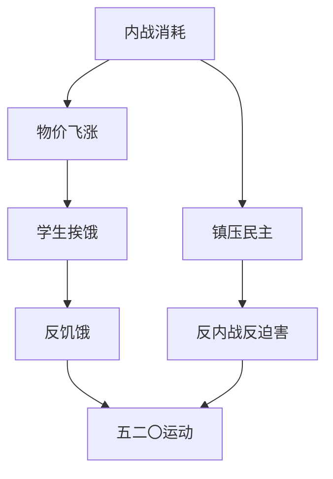
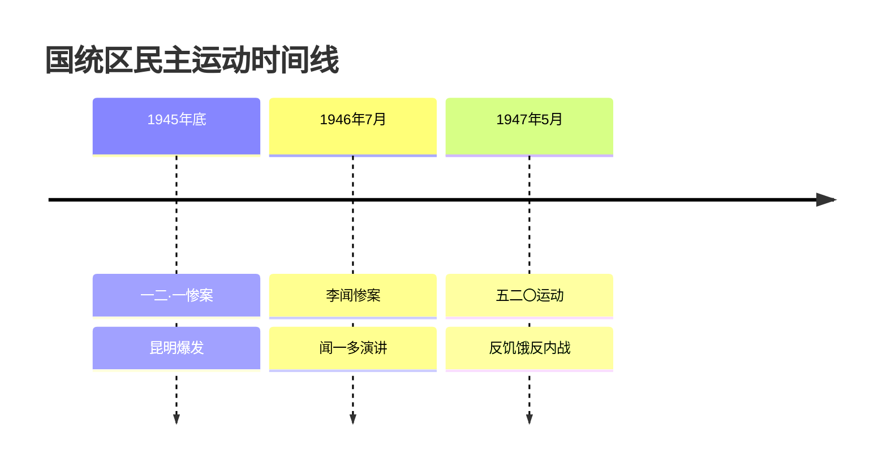

# 解放战争时期国统区学生反饥饿反内战运动

解放战争时期，正面战场炮火连天，那大后方的学生们在做什么？当饭都吃不饱、内战却越打越凶时，青年学生是如何用血肉之躯开辟出“第二条战线”的？

## 运动是什么与为什么爆发

1947年5月，国统区爆发了以==反饥饿、反内战、反迫害==为核心口号的学生爱国民主运动。这场运动不是凭空出现的，而是国民党政权倒行逆施的必然结果。

> [!IMPORTANT]
> 国统区通货膨胀、物价飞涨、货币贬值的根本原因是国民党发动内战导致的经济崩溃，而==绝非国际金融危机==造成的。

当时学生的生存状况有多恶劣？以1947年南京中央大学为例，公费生面临的最直接问题是==副食费用过低==，连最基本的营养都无法保障。饥饿交加之际，学生们不得不站出来发声。

## 运动的演进脉络

理解这段党史，需要把几次关键事件串联起来，注意它们发生的时间节点和诉求变化：

> [!NOTE]
> “第二条战线”是指在中国共产党领导下，国统区以学生运动为先导的人民民主运动，它与人民解放军的军事战线（第一条战线）相互配合，加速了国民党政权的覆灭。

## 相近概念辨析与易错点

考试中极易将不同时期的学生运动口号或人物张冠李戴。请对比以下核心要素：

| 事件 | 时间 | 基本口号/特征 | 关键人物 |
|---|---|---|---|
| 一二·九运动 | 1935年 | 停止内战，一致抗日 | 北平学生 |
| 一二·一运动 | 1945年 | ==反对内战，争取自由== | 遇难者含潘琰等 |
| 五二〇运动 | 1947年 | 反饥饿、反内战、反迫害 | 中央大学等高校 |

> [!WARNING]
> “一二·一”运动发生在抗战胜利后，其基本口号是“反对内战，争取自由”，==绝不是“停止内战，一致抗日”==（后者是一二·九运动的口号）。同时，“一二·一”惨案的遇难者包括李鲁连、潘琰、张华昌等人，但==闻一多并非该惨案遇难者==。

关于闻一多先生，他的《最后的演讲》是在谁的殉难报告会上发表的？答案是==李公朴==。1946年7月，李公朴被暗杀后，闻一多在报告会上拍案而起，随后也惨遭特务杀害，史称“李闻惨案”。

## 常见误区排雷

> [!CAUTION]
> 不要以为中共地下党在南京很安全！南京是原国民政府首都，特务密布，中共党组织处境极其险恶，==所谓“最危险的地方就是最安全的地方”是完全错误的判断==。

> [!T
