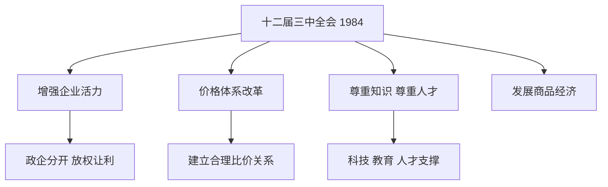

# 全面改革开辟社会主义发展新境界
### 从农村到城市：改革为什么必须“全面铺开”

家庭联产承包责任制让农村焕发活力，但城市经济仍受计划经济束缚：企业吃国家“大锅饭”，职工端“铁饭碗”，价格由国家统一制定，缺乏竞争与效率。农村改革的巨大成功证明“放权让利”行之有效，==改革重心自然从农村转向城市==，从局部试验转向全面体制变革。

> [!IMPORTANT]
> 1984 年 10 月，**党的十二届三中全会**一致通过《中共中央关于经济体制改革的决定》，首次明确提出我国社会主义经济是**公有制基础上的有计划的商品经济**，突破了把计划经济同商品经济对立起来的传统观念。

### 《决定》的核心举措

这份纲领性文件围绕“增强企业活力”这一中心环节，系统部署了城市经济体制改革：

| 改革维度 | 关键内容 | 解决的问题 |
| --- | --- | --- |
| 企业体制 | 政企分开、所有权与经营权适当分离 | 企业成为自主经营、自负盈亏的实体 |
| 价格体系 | 改革价格管理体制，逐步放调结合 | 价格信号失真、比价不合理 |
| 商品经济 | 有计划的商品经济定位 | 突破计划经济与商品经济对立 |
| 人才政策 | 尊重知识、尊重人才 | 为现代化建设提供智力支撑 |

### 与相近概念的区别

> [!WARNING]
> 常见误区是把“有计划的商品经济”误解为“以非公有制经济为主体”。==改革始终坚持公有制主体地位==，非公有制经济只是“有益的补充”，直到 1997 年十五大才明确为“重要组成部分”。

| 概念 | 提出时间 | 核心内涵 |
| --- | --- | --- |
| 计划经济 | 改革开放前 | 指令性计划配置资源 |
| 有计划的商品经济 | 十二届三中全会（1984） | 计划与市场内在统一 |
| 社会主义市场经济 | 十四大（1992） | 市场在资源配置中起基础性作用 |

### 改革如何回应人民需求

> [!IMPORTANT]
> 社会主义的根本目的是满足人民日益增长的物质文化需要。全面改革通过解放和发展生产力，让人民共享发展成果。

20 世纪 80 年代，家庭“三大件”从自行车、手表、缝纫机升级为**彩电、冰箱、洗衣机**——这一细节生动说明：改革不是抽象的制度变迁，而是人民生活品质的真实跃升。与此同时，1977 年恢复高考（方针：自愿报名、公平考试、择优录取）与“尊重知识、尊重人才”政策，为改革提供了人才保障，形成了经济发展与科教进步的良性互动。

> [!TIP]
> 记忆口诀：**“十二三中定商品，企业活力是中心；价格人才两手抓，公有主体不动摇。”**

### 算对了的例子

> 例题：《关于经济体制改革的决定》中提出的重大改革举措**不包括**（　）
> A. 尊重知识尊重人才　B. 以非公有制经济为主体　C. 价格体系改革　D. 增强企业活力

解析：《决定》明确提出 A、C、D 三项，且始终强调==公有制主体地位==。B 项把“补充”偷换为“主体”，属于典型干扰项。故选 **B**。

> [!NOTE]
> 全面改革与随后 1992 年确立的社会主义市场经济体制一脉相承：前者破除了“计划崇拜”，后者回答了“市场姓社还是姓资”的争论，共同开辟了中国特色社会主义发展新境界。
