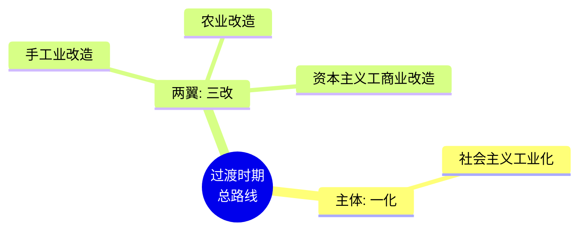

# 党在过渡时期总路线与从新民主主义向社会主义的过渡

# 党在过渡时期总路线与从新民主主义向社会主义的过渡

## 核心定义：一体两翼

1953年，中共中央正式提出党在过渡时期的总路线。其核心内容概括为==“一化三改”==。这并非两个独立的任务，而是一个相互关联的整体，形象地被称为==“一体两翼”==。

> [!IMPORTANT]
> **总路线完整表述**
> 要在一个相当长的时期内，逐步实现国家的**社会主义工业化**（主体），并逐步实现国家对**农业**、**手工业**和**资本主义工商业**的社会主义改造（两翼）。

## 为什么需要过渡？

新中国成立初期是**新民主主义社会**，存在多种经济成分。为了确立**社会主义基本制度**，必须解决两个根本问题：
1.  **生产力落后**：需要通过工业化建立独立的工业体系。
2.  **生产资料私有制**：需要将私有制转变为**社会主义公有制**。

> [!NOTE]
> **历史定位**
> 1956年三大改造基本完成，标志着中国从新民主主义社会跨入**社会主义社会**，进入**社会主义初级阶段**。

## “一五”计划与三大改造的关系

在实施总路线的过程中，“一五”计划（1953-1957）是具体抓手。很多同学容易混淆“一五”计划的任务重点。

| 维度 | 社会主义工业化 (一化) | 社会主义改造 (三改) |
| :--- | :--- | :--- |
| **性质** | 发展生产力 | 变革生产关系 |
| **对应事件** | “一五”计划集中力量建设 | 农业、手工业、资本主义工商业改造 |
| **地位** | 主体 | 两翼 |

> [!TIP]
> **解题关键**
> “一五”计划的主要任务具有**双重性**：既包括集中力量进行**工业化建设**，也包括加快推进各经济领域的**社会主义改造**。

## 常见误区与真题解析

### 易错点辨析

> [!WARNING]
> **高频陷阱**
> 1. **重工业 vs 资本主义工商业**：“三大改造”针对的是**生产资料所有制**，即农业、手工业、资本主义工商业。**重工业**属于工业化建设的领域，不属于“改造”对象。
> 2. **时间点**：过渡时期总路线提出于**1953年**，而非1949年或1956年。

### 真题实战

**例题 1**：“三大改造”具体指（ ）。
*   A. 农业
*   B. 手工业
*   C. 重工业
*   D. 资本主义工商业

**解析**：根据“一化三改”定义，三改针对的是私有制经济成分。重工业是工业化的重点，不是改造对象。
✅ **正确答案：ABD**

**例题 2**：“一五”计划的主要任务是（ ）。
*   A. 加速推进三线建设
*   B. 加速推进社会主义市场经济建设
*   C. 集中力量进行工业化建设
*   D. 加快推进各经济领域的社会主义改造

**解析**：
*   A项“三线建设”是20世纪60年代的事；
*   B项“社会主义市场经济”是改革开放后的目标；
*   C、D项分别对应“一化”和“三改”，符合过渡时期总路线要求。
✅ **正确答案：CD**

## 政治制度的同步确立

在经济基础变革的同时，上层建筑也在完善。1954年第一届全国人大召开，制定第一部宪法，确立了==人民代表大会制度==这一根本政治制度。同时，政协职能转换，民族区域自治制度进一步确立，共同构成了社会主义政治制度的框架。
