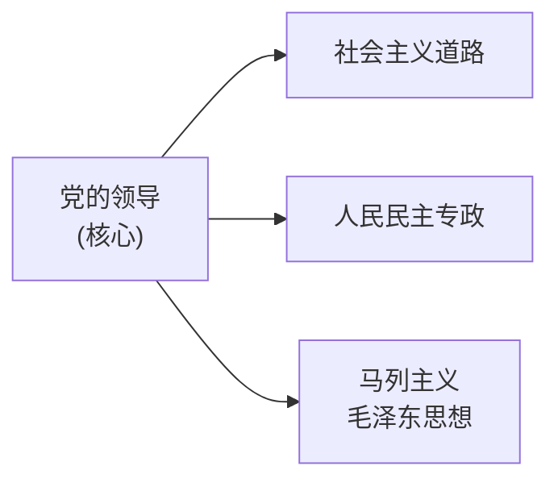
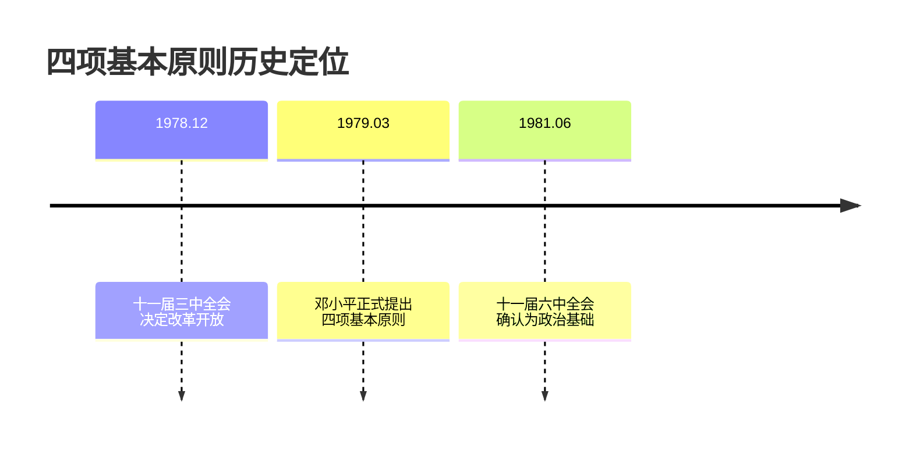

# 四项基本原则的提出及其核心地位

## 为什么需要这四条“大规矩”？

1979 年前后，社会上冒出了一些不和谐的声音：有人怀疑社会主义道路走错了，有人主张放弃党的领导，还有人照搬西方那一套，似乎觉得“自由化”才是出路。这股思潮直接冲击着刚起步的改革开放大业。

邓小平敏锐地察觉到问题的严重性：如果不给改革画一条清晰的底线，那就可能在“变”的过程中把方向都弄丢了。于是他在 1979 年 3 月的理论工作务虚会上明确提出：==必须坚持四项基本原则==。

> [!IMPORTANT]
> 四项基本原则就是四条不可动摇的政治底线——**坚持社会主义道路、坚持人民民主专政、坚持中国共产党的领导、坚持马列主义毛泽东思想**。它们是改革开放的“方向盘”与“定海神针”。

很多同学易混淆：改革开放是“变”，四项基本原则是“不变”，二者会不会打架？
恰恰相反：==四项基本原则保证了改革开放在社会主义框架内推进，而不是滑向“全盘西化”==。这就是南邮考题中反复出现的“改革开放一定要坚持社会主义方向”这句话的逻辑根源。

## 四条分别对应什么大事

下面的表帮你快速理清每条原则的对应指向与常见误区：

| 四项基本原则 | 指向的核心问题 | 容易错的理解 |
|------------|------------|------------|
| 坚持社会主义道路 | 走什么路 | “改革开放就是搞资本主义那一套” ❌ |
| 坚持人民民主专政 | 谁的国家、谁的政权 | “搞市场经济就不要专政了” ❌ |
| 坚持中国共产党的领导 | 谁来领导、谁说了算 | “党政分开就是不要党的领导” ❌ |
| 坚持马列主义毛泽东思想 | 思想指南 | “搞活了就可以抛弃老理论” ❌ |

> [!TIP]
> 考试里遇到多选，看到这四个并列的“坚持”，大胆选 ABCD 即可。题目变来变去，核心选项不会少。

## 核心中的核心：党的领导

四条原则有主次。其中最要害的就是**党的领导**。邓小平本人多次强调：“==坚持四项基本原则的核心，是坚持党的领导==”。为什么呢？
如果取消党的领导，那么谁来组织人民？谁来坚持社会主义道路？谁来保障人民民主专政？谁来在实践中发展马列主义？没有党的领导，其他三条将迅速沦为口号，甚至被架空。

> [!WARNING]
> 常见陷阱：题目问“坚持四项基本原则的核心”，选项里若同时出现“社会主义道路”和“党的领导”，一定要选==党的领导==。试卷里的判断题 13 就在考这个点。

## 从立国之本到共同政治基础

用一句话讲清楚四项基本原则在党史中的定位：
> [!IMPORTANT]
> 四项基本原则是==立国之本==，改革开放是强国之路。

党的十一届六中全会指出，四项基本原则是全党团结和全国各族人民团结的共同政治基础。对这个定义要特别注意：它不是单纯的经济政策（不是“改善民生”），不是工作方法（不是“密切联系群众”），也不是特定社会任务（不是“解决三农问题”），而是==政治基础==。单选题里一旦出现这个词，答案几乎注定是四项基本原则。

## 一图理清时间线与逻辑链

为什么不是在三中全会就提出？因为三中全会的主要任务是结束“以阶级斗争为纲”、转向经济建设，到次年理论务虚会时，社会思想波动已经暴露得比较充分，再不亮明底线，改革可能走偏。所以：==先确立经济建设中心，紧接着立下思想底线==。

> [!CAUTION]
> 判断题的常见坑：“社会主义国家的立国之本是改革开放”——这句话是错的，立国之本只能是四项基本原则。改革开放是“强国之路”，地位不同，千万别混。
