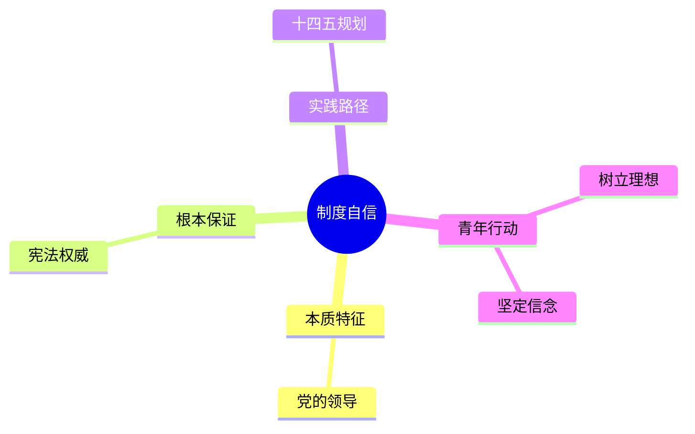

# 坚定制度自信，阔步迈向中国式现代化新征程

# 坚定制度自信，阔步迈向中国式现代化新征程

在社会主义发展史的宏大叙事中，理解“制度自信”与“中国式现代化”的关系，是把握当代中国发展逻辑的关键。这不仅是一个政治命题，更是青年学子需要内化于心的行动指南。

## 核心内涵：什么是中国式现代化的基石？

==中国特色社会主义最本质的特征是中国共产党的领导==。这是理解所有制度优势的逻辑起点。如果没有这个前提，后续的现代化建设就失去了主心骨。

> [!IMPORTANT]
> 核心结论：制度自信源于实践成效。中国式现代化不是西方模式的翻版，而是基于中国国情、由党领导人民探索出的新路。

为了直观展示这一逻辑体系，我们可以用思维导图梳理其构成：

## 关键节点：时间线与历史坐标

记忆历史事件的时间点是应对选择题的硬功夫。我们需要厘清几个关键的时间坐标，它们构成了制度运行的时间轴。

| 事件/概念 | 关键时间/年份 | 备注 |
| :--- | :--- | :--- |
| 西藏自治区一届人大 | **1965年** | 民族区域自治制度实践 |
| 首个国家宪法日 | **2014年12月4日** | 弘扬宪法精神 |
| “十四五”规划实施 | **2021年起** | 开启全面建设社会主义现代化国家新征程 |

> [!TIP]
> 记忆技巧：宪法日选在12月4日是因为1982年现行宪法通过日期是12月4日。2014年是设立之年，故为首个。

## 常见误区与辨析

在学习过程中，容易混淆“书本知识”与“实践信仰”的关系。

> [!WARNING]
> 易错坑：认为“最重要的是学好书本上的知识”。
> **解析**：虽然学习重要，但同心共筑中国梦，更需要的是**树立远大理想**、**坚定马克思主义信仰**以及**认真学习党史、国史、世界史**。单纯的书本知识若脱离信仰和历史视野，无法形成真正的制度自信。

例如，在面对多选题“为了同心共筑中国梦，青年同学应该怎么做？”时，选项 D 往往是干扰项。正确的逻辑是：信仰（B）指引方向，历史学习（C）提供智慧，理想（A）提供动力，三者缺一不可。

## 实践要求：青年如何作为？

制度自信不是抽象的口号，它落实到具体行动中，就是要求领导机关和领导干部**带头冲在前、干在先**，这也是我们党走向成功的关键。对于南邮学子而言，这意味着要将个人理想融入国家发展大局。

> [!NOTE]
> 延伸思考：为什么强调“领导带头”？因为制度的生命力在于执行，而执行的关键在于表率。这与“中国共产党领导”这一最本质特征是一脉相承的。

综上所述，坚定制度自信，既要知晓**1965年**西藏人大召开这样的历史事实，也要明确**2021年**开启的“十四五”新阶段，更要在行动上拒绝唯书本论，做到知行合一，真正阔步迈向中国式现代化的新征程。
