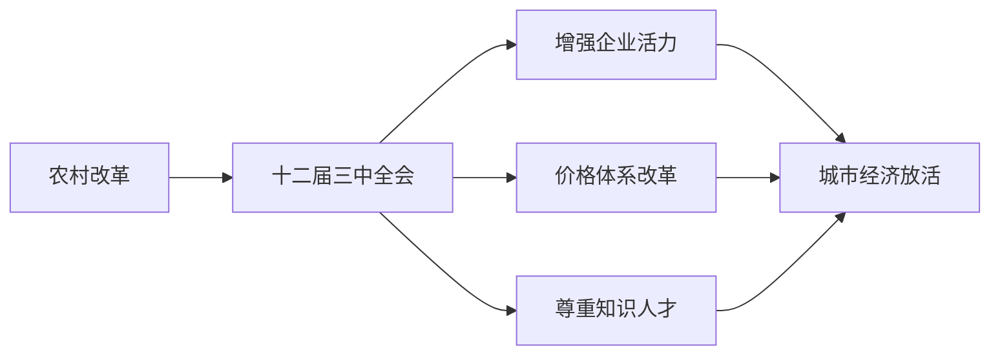

# 以城市为重点推进经济体制改革（十二届三中全会）

1984 年党的十二届三中全会通过了《关于经济体制改革的决定》，标志着改革从农村拓展到以城市为重点的整个经济领域。这份决定不是简单的文件，它第一次明确提出了 ==“公有制基础上的有计划的商品经济”==，也就是把商品经济放到了社会主义经济的核心位置上。请自己想想：为什么改革重心会由农村转向城市？答案是，农村改革已经取得了初步成效，但城市里的国企、价格体制、分配制度这些硬骨头不解决，整个经济就无法继续放活。

## 它是什么

十二届三中全会的核心动作是出台《关于经济体制改革的决定》，提出的重大举措包括：

- ==增强企业活力==，尤其是国有企业的自主经营权
- ==价格体系改革==，逐步放开管制，形成市场化价格
- ==尊重知识、尊重人才==，调动知识分子和科技人员积极性
- 政企职责分开，扩大企业自主权

## 和相近概念的区别

| 会议 | 时间 | 标志 |
|------|------|------|
| 党的十一届三中全会 | 1978 | 改革开放的起点 |
| ==党的十二届三中全会== | ==1984== | ==改革由农村走向城市== |
| 党的十四大 | 1992 | 提出建立社会主义市场经济体制 |

> [!IMPORTANT]
> 十二届三中全会 ≠ 十一届三中全会。==1984 年、《关于经济体制改革的决定》、以城市为重点==，这三个关键词必须一起记住。

> [!WARNING]
> 易错点：决定里并没有说“以非公有制经济为主体”。当时仍是 ==公有制为主体==，只是强调发展商品经济、放开部分管制。看到“非公有制为主体”这类选项，直接排掉。

## 做对一道题

题干：《关于经济体制改革的决定》中提出的重大改革举措不包括（　）。
A. 尊重知识尊重人才　B. 以非公有制经济为主体　C. 价格体系改革　D. 增强企业活力

想一想：A、C、D 都是决定里明确写的；B 悄悄把“公有制为主体”换成了“非公有制”，属于偷换概念。答案是 ==B==。

> [!TIP]
> 记忆口诀：“==84 城市决定==”——1984 年、城市、《决定》，三个字锁定考点。

> [!NOTE]
> 判断题若写“十二届三中全会标志着改革开始由农村走向城市和整个经济领域”，这是 ==正确== 的标准表述。
