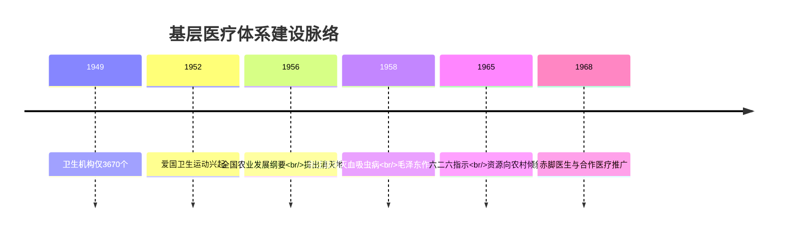

# 六亿神州尽舜尧：爱国卫生运动与农村基层医疗体系建设

## 它是什么

“六亿神州尽舜尧”出自毛泽东《七律二首·送瘟神》，写的是江西余江县消灭血吸虫病后“六亿人民尽皆尧舜”的公共卫生图景。这个知识点讲的是新中国在“一穷二白”条件下，如何通过==爱国卫生运动==和==农村基层医疗体系==两条腿走路，把人均预期寿命从 35 岁逐步拉起来。

> [!IMPORTANT]
> 新中国成立初期，全国仅有各类卫生机构 **3670 个**，且 80% 集中在城市；农村几乎没有现代医疗，疫病横行、缺医少药是常态。

## 为什么需要

衡量居民健康水平的主要指标有三个：**人均预期寿命、婴儿死亡率、孕产妇死亡率**——注意，==婴儿出生率不是健康指标==，它只是人口学指标。旧中国这三项指标全面落后，血吸虫病、疟疾、黑热病等地方病肆虐，直接威胁劳动力与新生政权稳定。

## 怎么做

两条主线并进：

| 维度 | 爱国卫生运动 | 农村基层医疗体系 |
|------|------------|----------------|
| 主体 | 群众运动、全民参与 | 国家主导、三级网络 |
| 手段 | 除四害、讲卫生、环境改造 | 县医院—公社卫生院—大队卫生室 |
| 标志成果 | 余江县消灭血吸虫病 | 赤脚医生、农村合作医疗 |
| 对应诗词 | 《送瘟神》“六亿神州尽舜尧” | “借问瘟君欲何往” |

关键机制是**“预防为主、防治结合”**：爱国卫生运动解决“少生病”，基层医疗网络解决“病有医”。赤脚医生亦农亦医、半农半医，用最低成本把医疗服务送到了田埂上。

## 常见的坑

> [!WARNING]
> - 《送瘟神》的创作背景是==消灭血吸虫病==，不是疟疾、丝虫病或黑热病。
> - 健康指标三件套里没有“出生率”，看到“率”就全选会丢分。
> - 爱国卫生运动始于 **1952 年**（抗美援朝反细菌战背景），不要写成 1949 或 1958。

## 一个算对了的例子

> [!TIP]
> 选择题常考：“新中国成立初期全国仅有各类卫生机构（ ）。” 记住口诀 ==“三六七十”==——3670 个，对应选项 C。联想：3670 → “三六九等”的谐音变体，帮你锁定数字。

> [!NOTE]
> 余江县消灭血吸虫病是 1958 年，毛泽东读到《人民日报》报道后“浮想联翩，夜不能寐”，写下《七律二首·送瘟神》。“六亿神州尽舜尧”正是对人民群众在公共卫生实践中主体地位的肯定——这与后来“以人民为中心”的卫生健康观一脉相承。
