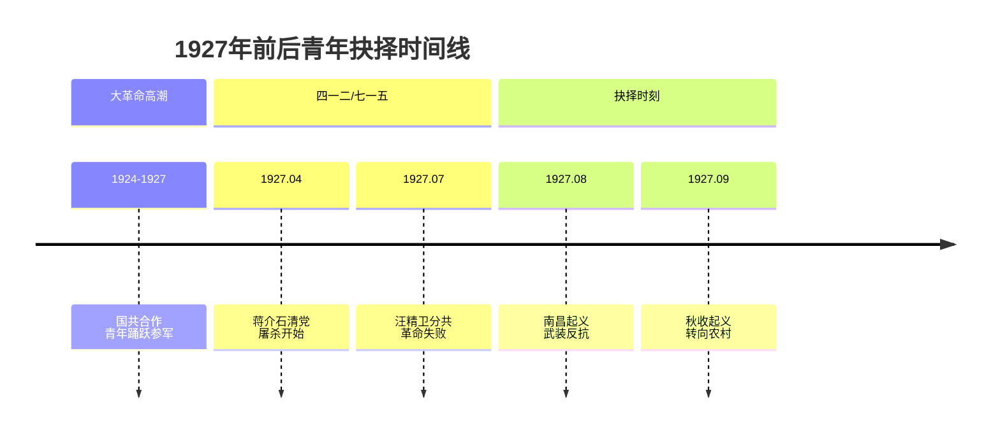

# 大革命失败后青年面临的历史抉择

# 大革命失败后青年面临的历史抉择

## 历史背景与核心困境

1927年，国民党右派发动反革命政变，大肆屠杀共产党人和革命群众。中国共产党陷入被瓦解和消灭的严重危险之中，革命成果毁于一旦。对于当时的青年而言，这不仅是政治信仰的考验，更是生死的抉择。

> [!IMPORTANT]
> ==1927年==是党史上的关键转折点，党处于幼年时期，尚未能将马列主义基本原理与中国革命实践完全结合。

面对白色恐怖，青年群体出现了分化：有的脱党退团，有的叛变投敌，而真正的革命者则在血泊中重新站立。这一过程正如电影《大浪淘沙》所喻示的，时代的大浪不断筛选着每一个个体。

## 抉择的逻辑与结果

在极端恶劣的环境下，国民党当局通过多种手段逼迫被捕党员投降。理解这些手段有助于我们认识坚守信仰的难度。

| 诱降/逼供手段 | 具体表现 | 目的 |
| :--- | :--- | :--- |
| **亲情诱降** | 利用家属劝降 | 瓦解心理防线 |
| **严刑拷打** | 肉体摧残 | 迫使屈服 |
| **挑拨离间** | 制造党内矛盾 | 破坏组织团结 |
| **环境压迫** | 恶劣监狱条件 | 消磨革命意志 |

> [!TIP]
> 记忆口诀：**亲、刑、挑、境**。这四种方式构成了当时对共产党员的全方位围剿。

尽管面临如此高压，以靳恭绶、顾达明为代表的先进青年，最终选择了加入中国共产党。这并非偶然，而是客观社会需要与个人主观能动性共同作用的结果。

## 常见误区与考点辨析

在学习这部分内容时，容易混淆时间点和人物结局，需特别注意以下“坑”：

> [!WARNING]
> **易错点1**：中国社会主义青年团一大召开地点。
> *   错误认知：浙江。
> *   ==正确事实==：**广州**（1922年5月）。浙江是中共一大会址之一，勿张冠李戴。

> [!CAUTION]
> **易错点2**：党在1927年的成熟度。
> *   错误认知：党已能熟练结合马列主义与中国实际。
> *   ==正确事实==：当时党处于==幼年时期==，缺乏经验，导致革命遭受严重挫折。结合是一个漫长的探索过程，直至遵义会议后才逐步成熟。

## 典型例题解析

**题目**：电影《大浪淘沙》的四位青年中，最终加入中国共产党的是靳恭绶和顾达明。（）

**解析**：
此题考察对革命历程中人物命运的理解。电影中四位青年代表了不同的道路：有的成为革命烈士，有的中途动摇，有的彻底背叛。靳恭绶和顾达明在经历迷茫与斗争后，坚定了共产主义信仰，最终入党。

*   **判断依据**：历史事实与文艺作品的对应关系。
*   **结论**：**√**。

通过这道题可以看出，历史的抉择不是抽象的口号，而是具体人物在具体环境下的行动。对于南邮学子而言，理解这一过程，有助于深刻体会“星星之火，可以燎原”背后的艰难与必然。
