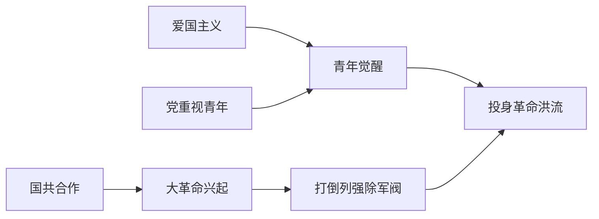

# 国民革命洪流中青年与吾辈的作为

国民革命洪流中青年与吾辈的作为，讲的是1924—1927年大革命时期，青年为什么大规模投身革命、怎样发挥作用，以及当代青年如何接续使命。复习时要把“时代背景—青年行动—历史启示”连成一条线，而不是只背人物和事件。

## 大革命为何形成青年洪流

1924年，国共合作推动大革命兴起，其宗旨是==“打倒列强，除军阀”==。与五四运动主要由先进青年知识分子参与相比，大革命吸引了更广泛的青年，原因主要有三点：

- 爱国主义精神已经深深融入青年的血脉和骨髓；
- 青年力量集体觉醒，革命火种深入思想和灵魂；
- 中国共产党重视青年工作，这是其与生俱来的基因。

因此，“参与革命能够提升个人知识和能力”不是题目所强调的根本原因，不能用它替代政治觉醒、家国情怀和党的领导。

## 用史实理解青年的革命作为

毛泽东在1927年的评论中指出，国民革命需要一个大的农村变动；辛亥革命没有这个变动，所以失败了。这说明青年投身革命不能停留在城市宣传和一般动员，还要深入工农、认识中国社会。对应考点是：==1927年这一评论的作者是毛泽东==。

邓恩铭则体现了青年革命者从接受新思想到组织实践的成长路径。他在中学时期参与发起济南共产党早期组织，参加中共一大，大革命时期领导胶济铁路大罢工。可用下表避免人物事迹混记：

| 人物或事件 | 正确对应 | 易混点 |
|---|---|---|
| 毛泽东 | 1927年强调大的农村变动 | 不是李大钊、陈独秀 |
| 邓恩铭 | 济南早期组织、中共一大、胶济铁路大罢工 | 山海关铁路工人大罢工不属其一大后领导事迹 |
| 八国通牒 | 1926年要求拆除大沽口国防设施 | 不是旅顺、大连、秦皇岛 |

> [!WARNING]
> “胶济铁路”与“山海关铁路”是高频干扰项；判断人物事迹时，要同时核对时间、地点和事件，不能只凭“工人运动”这一共同标签。

## 从青年作为到吾辈担当

大革命中的青年把个人理想同民族独立、人民解放联系起来。今天传承这种精神，不是简单重复历史行动，而是把爱国情、强国志、报国行统一起来。当代中国青年的正确认识包括：中国青年始终是实现中华民族伟大复兴的先锋力量；要坚定理想信念，勇担时代使命；既有深厚家国情怀，也要追求高远、求真务实。

> [!TIP]
> 记忆主线：**五四先觉醒—大革命广动员—新时代勇担当**。多选题若选项同时体现理想信念、家国情怀、先锋力量和务实奋斗，通常都应肯定；若把革命动机归结为个人获利或单纯提升能力，则要警惕。

## 做对一道题

题目：1927年，谁评论指出“国民革命需要一个大的农村变动”？

先抓两个限定词：**1927年**和**农村变动**。它们指向毛泽东对农民运动、国民革命与辛亥革命教训的分析，因此选 **D. 毛泽东**。若只看到“国民革命”就选陈独秀，或看到“评论”就选李大钊，都是忽略核心限定造成的失分。
