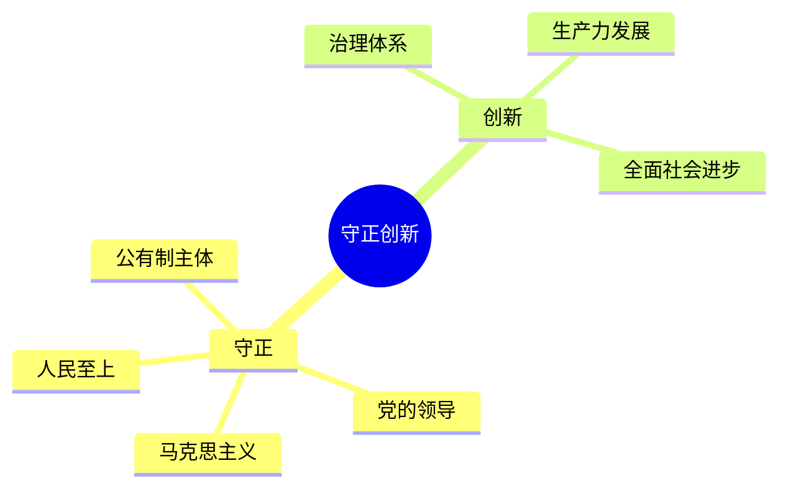

# 守正创新，书写世界社会主义的光明未来

## 它是什么

在社会主义发展史里，“守正创新，书写世界社会主义的光明未来”讲的是：世界社会主义要想在 21 世纪继续发展，既不能丢掉根本原则，也不能僵化停滞。

可以先想一个问题：如果一个国家自称搞社会主义，但不再服务人民、不再坚持党的领导、不再以马克思主义为指导，它还能叫社会主义吗？反过来，如果只守旧不前，又如何在新时代发展生产力？

其中“守正”对应课件里的==坚持和发展社会主义的核心要则==。

## 为什么需要

社会主义不是标签，而是制度与价值的统一。只有守住核心要则，才能避免改旗易帜；只有推进创新，才能解决发展中的问题，书写光明未来。

> [!IMPORTANT]
> 下列五条全部属于核心要则：人民至上、党的绝对领导、马克思主义指导地位、公有制主体并发展生产力、社会全面发展。

## 怎么做：核心要则表格

| 要则 | 课件原话要点 |
|---|---|
| 人民至上 | 社会主义永远要坚持人民至上 |
| 党的领导 | 永远坚持党的绝对领导 |
| 意识形态 | 坚持马克思主义指导地位 |
| 经济制度 | 公有制为主体，努力发展生产力 |
| 社会形态 | 社会主义是全面发展的社会 |

同时，要通过完善制度来推进创新。比如十九届四中全会文件第一次系统描绘中国特色社会主义制度图谱。

## 相近概念区别

“守正”不是保守不变；“创新”也不是离开原则乱改、否定公有制或党的领导。二者统一于坚持和发展中国特色社会主义。

## 常见的坑

> [!WARNING]
> 看到“第一次系统描绘中国特色社会主义制度图谱”，别选机构改革文件或基层组织条例。

## 一个算对了的例子

选择题：以下文件第一次系统描绘我们中国特色社会主义制度图谱的是？

- A《深化党和国家机构改革的决定》
- B《深化党和国家机构改革方案》
- C《中共中央关于坚持和完善中国特色社会主义制度、推进国家治理体系和治理能力现代化若干重大问题的决定》
- D《党和国家机关基层组织工作条例》

答案是 ==C==。注意题干里是“坚定/坚持和完善制度、推进国家治理体系和治理能力现代化”，属于国家治理体系现代化关联内容，而非机构改革。

另一道多选题：核心要则包括人民至上、党的绝对领导、马克思主义指导地位、公有制主体并发展生产力，答案 ==ABCD==。
