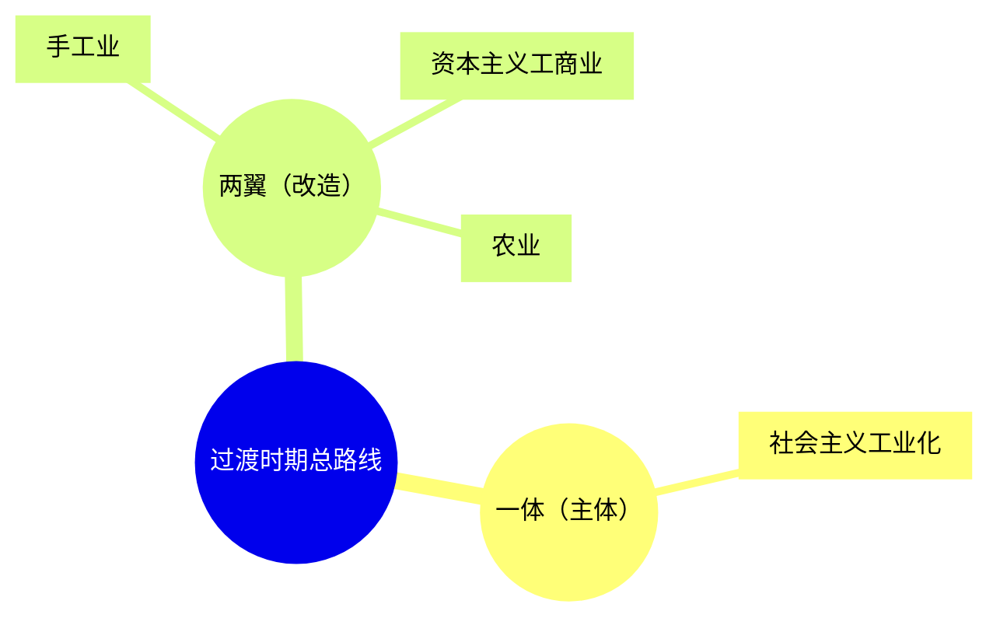
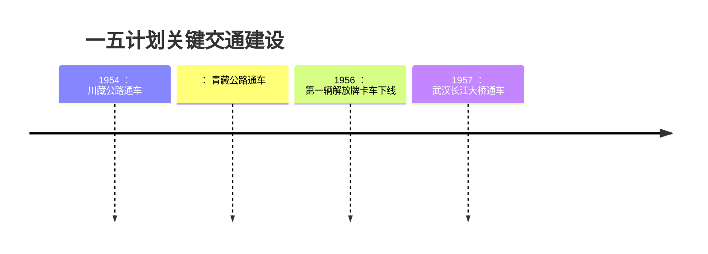

# 过渡时期总路线与一五计划推动的工业振兴

## 过渡时期总路线与“一五”计划

1953 年，国民经济基本恢复，但中国依然是一个落后的农业国。我们能造桌椅板凳，却造不出一辆汽车、一架飞机。问题摆在面前：怎样才能让国家真正强大起来？

### 总路线的“一体两翼”

中共中央提出的过渡时期总路线，核心就是“一化三改”，把它比喻为一只飞翔的鸟，更容易理解：

> [!IMPORTANT]
> ==“一体”是主体：社会主义工业化==，要优先发展重工业。
> ==“两翼”是支撑：对农业、手工业、资本主义工商业的社会主义改造==。
> “一体”提供物质基础，“两翼”提供制度保障，缺一不可。

> [!WARNING]
> **常见误区**：只记得“三大改造”，忽略了“工业化”才是主体。总路线不是单纯改变所有制，而是工业建设和改造同时并举。

### “一五”计划：把工业蓝图钉在大地上

1953 年开始的“一五”计划，就是社会主义工业化的第一场硬仗。核心任务是集中力量进行 156 个重点项目建设，奠定工业体系骨架。

**为什么必须从重工业起步？**
当时中国轻工业有一定基础，但缺乏机器设备和原材料工业。如果没有钢铁、机械、能源，连纺织厂的机器坏了都没法换零件。先有重工业，才能带动轻工业、农业的现代化。

**落子东北：长春第一汽车制造厂**
1951 年初，长春西南郊被选中建厂。1956 年，新中国第一辆“解放”牌卡车下线。
==中国从 **1956 年** 起，真正具备了自主批量生产汽车的能力。==

> [!NOTE]
> **辨析**：1954 年通车的是**川藏、青藏公路**（AC 选项），川藏铁路和青藏铁路是几十年后的事。考题常用时间错配设坑。

### 社会主义改造：迈向公有制的关键一步

1952 年下半年至 1956 年，三大改造基本完成：

| 领域 | 主要方式 | 结果 |
| :--- | :--- | :--- |
| 农业 | 农业合作化（互助组→初级社→高级社） | 个体私有制 → 集体所有制 |
| 手工业 | 手工业合作化 | 个体私有制 → 集体所有制 |
| 资本主义工商业 | 和平赎买、公私合营 | 资本家私有制 → 全民所有制 |

> [!CAUTION]
> 三大改造的“三”指的是**农业、手工业、资本主义工商业**，重工业属于“一化”的主体，不属于“三改”的内容。考试选项里常把“重工业”混进去作干扰项。

这次改造的意义在于：生产资料私有制转变为社会主义公有制，中国从新民主主义社会跨入社会主义社会，进入社会主义初级阶段。

### 教育领域的配套：院系调整

工业化需要人。50 年代院系调整的大背景，正是国家建设百废待兴，急需大批专业人才。新中国成立伊始，高等教育存在三大问题：

> [!TIP]
> ① 高校分布严重失衡，沿海集中，内地边远地区薄弱。
> ② 工程、师范、医药、农林等系科办学数量和质量不足。
> ③ 院系设置分散，难以发挥集中优势和规模效益。

调整方向就是重点发展工科和师范，把分散的系科合并重组。当时人才缺口巨大，**绝非“供大于求”**。
