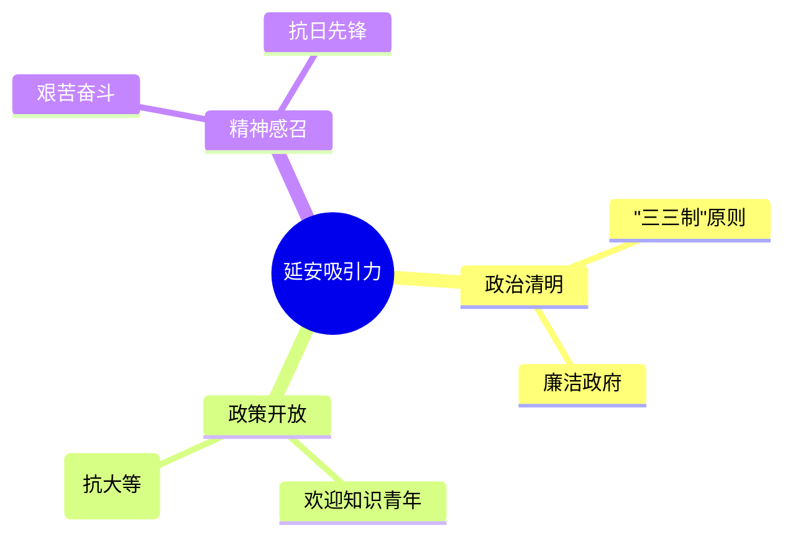

# 连天烽火中延安成为革命圣地的原因

## 延安为何成为革命圣地？

在抗日战争全面爆发的连天烽火中，==延安==从一座西北小城跃升为全国青年心中的“革命圣地”。这并非偶然，而是政治清明、政策开放与精神感召共同作用的结果。

> [!IMPORTANT]
> 核心结论：延安之所以成为圣地，是因为它代表了==抗日救亡的希望==、==民主政治的实践==以及==艰苦奋斗的精神==。

### 为什么需要去延安？（吸引力分析）

当时国统区腐败横行、抗战态度消极，而延安呈现出截然不同的气象。我们可以从以下维度对比：

| 维度 | 国统区/沦陷区 | 延安（陕甘宁边区） |
| :--- | :--- | :--- |
| **政治制度** | 一党专政，独裁倾向 | ==“三三制”==民主政权 |
| **政府作风** | 贪污腐败，效率低下 | ==精兵简政==，廉洁从政 |
| **社会氛围** | 压抑沉闷，特务统治 | 自由开放，朝气蓬勃 |
| **精神面貌** | 悲观失望 | ==自力更生==，艰苦奋斗 |

### 青年是如何奔赴延安的？（路径与构成）

面对封锁，全国各地的知识青年通过多种途径突破重重阻碍来到延安。

> [!TIP]
> 记忆技巧：来源“四通八达”，出身“五湖四海”。

根据考题梳理，青年们主要通过以下四种途径抵达：
1. 由==八路军办事处==介绍而来；
2. 通过中国共产党==直接邀请==而来；
3. 看到报刊上根据地学校的==招生简章==而来；
4. 由进步的==社会名人==介绍而来。

这些青年的出身也极具广泛性，涵盖了==华侨==、==旧式官僚家庭==、==农民/地主家庭==以及==知识分子家庭==。这说明延安的统一战线政策成功凝聚了全民族的力量。

### 常见的坑与辨析

在学习这部分内容时，容易混淆人物与作品，或误解政策细节。

> [!WARNING]
> 易错点警示：
> 1. 《义勇军进行曲》由田汉作词，==聂耳==作曲，而非冼星海（冼星海代表作《黄河大合唱》）。
> 2. “三三制”是指共产党员、非党左派进步分子、中间分子各占三分之一，是==抗日民族统一战线==在政权建设上的体现。

### 真题演练

**例题**：抗日战争全面爆发后，全国出现了知识青年奔赴（）的热潮。
*   A. 北平
*   B. 延安
*   C. 南京
*   D. 西安

**解析**：
此题考查历史事实。随着日军侵华加剧，北平、南京等地相继沦陷或处于危险之中，而延安作为中共中央所在地，成为了抗日指挥中心和民主模范区。因此，大量爱国青年冲破封锁，奔赴==延安==。

**答案**：B

> [!NOTE]
> 延伸思考：习近平总书记在总结延安精神时强调，==自力更生、艰苦奋斗==是我们共产党人的品质，也是立党立国的根本。这一精神至今仍具有重要的时代价值。
