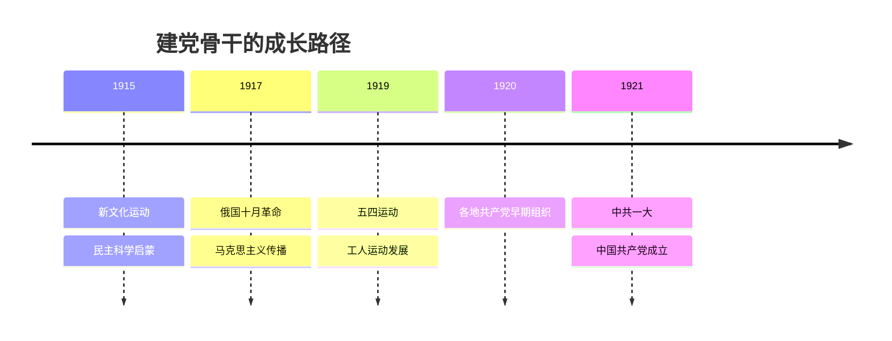
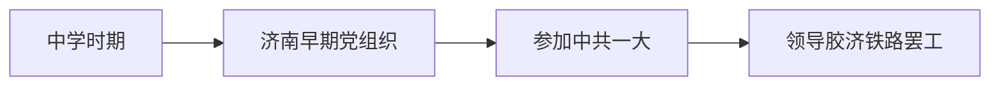

# 中国共产党成立时建党人物的年岁与背景

## 一、知识点是什么

“中国共产党成立时，建党人的年岁与背景”，主要考察两点：

1. **一大代表的年龄结构**：建党骨干总体年龄较小，许多人是在青年时期接受新思想、投身革命。
2. **建党的历史背景**：中国共产党并非凭空产生，而是在近代中国内忧外患、马克思主义传播、工人运动兴起等条件下成立的。

> [!IMPORTANT]
> 本知识点的核心不是死记每位代表的确切年龄，而是理解：**中国共产党的创建者是一批青年先进分子，他们年龄虽小，却具有先进政治主张、先进理论指导和先进革命实践。**

## 二、为什么需要从“年岁”看建党

建党初期，党员人数少、年龄普遍较轻，是党史中的鲜明特点。青年人社会阅历相对有限，为什么能够承担救亡图存的时代重任？

关键在于，==先进青年较早接触新思想，并主动把个人理想同国家和民族命运联系起来==。因此，不能简单用年龄小来判断政治幼稚或能力不足。

例如，1921年中共一大代表的平均年龄只有28岁左右，最年长者也只有45岁。这说明中国共产党成立时具有鲜明的青年化特征。

其中，五四运动具有重要催化作用。它促进了马克思主义在中国的传播，推动了工人阶级登上政治舞台，也促进了青年群体的思想觉醒。习近平总书记指出，五四运动孕育了以爱国、进步、民主、科学为主要内容的伟大五四精神，其核心是爱国主义精神。

> [!TIP]
> 记忆方法：**思想启蒙—理论传播—运动实践—组织建立—中共成立**。  
> 五四运动既是爱国运动，也是新思想和工人运动发展的重要转折点。

## 三、他们的先进性体现在哪里

课件将建党青年的先进性概括为三个方面：

| 先进性 | 具体表现 | 判断要点 |
|---|---|---|
| 先进政治主张 | 主张推翻旧制度、建立新社会 | 不只是个人改良 |
| 先进理论指引 | 接受马克思主义并开展传播 | 有理论方向 |
| 先进革命实践 | 创办刊物、组织工人运动、建立党组织 | 有实际行动 |

其中，马克思主义中国早期传播的重要代表之一是**李大钊**。他在《我的马克思主义观》等文章中系统介绍马克思主义，推动其与中国实际相结合，为中国共产党成立准备了思想和理论条件。

> [!IMPORTANT]
> 课件多选题的标准答案是 **A、C、D**：先进政治主张、先进理论指引、先进革命实践。  
> “先进经济思想”不属于该题所列的三个方面。

## 四、怎样认识早期建党人的实践

早期共产党人不仅研究理论，而且立即投入现实革命实践。典型例子是邓恩铭。

邓恩铭在中学时期参与发起济南共产党早期组织，随后出席中共一大，是中国工人运动早期领导人之一。大革命时期，他领导了胶济铁路工人大罢工，为山东工人运动作出重要贡献。

> [!WARNING]
> 易错点：邓恩铭参加的是**中共一大**，不是中共二大；领导胶济铁路工人大罢工发生于**大革命时期**。“一大后领导山海关铁路工人大罢工”混淆了不同事件与阶段，表述不当。

还有一个常见误区：邓恩铭、王尽美等人一大后积极组织的是**山东等地的工会运动**，不能写成“山西的工会”。

## 五、从创立走向全国

中共一大于1921年7月在上海开幕，后转移到浙江嘉兴南湖的一艘游船上继续举行并闭幕。因此，一大代表转移到的地方是**嘉兴**，不是宁波或苏州。

| 地点 | 与一大关系 |
|---|---|
| 上海 | 一大开幕地 |
| 嘉兴 | 一大转移后闭幕地 |
| 宁波、苏州 | 与一大闭幕无直接关系 |

中共一大宣告中国共产党正式成立。中国共产党的成立，是中国历史上开天辟地的大事变，自从有了中国共产党，中国革命的面貌就焕然一新了。

## 六、复习时应抓住什么

复习这一知识点，可以沿着三个问题思考：

1. **他们有多年轻？**  
   一大代表平均年龄约28岁，呈现青年化特征。

2. **他们为什么能够建党？**  
   先进青年在五四运动前后形成爱国、进步、民主、科学的觉悟，并逐步确立马克思主义信仰。

3. **先进性如何证明？**  
   不仅有先进主张和理论，而且有组织工人运动、建立共产党早期组织等革命实践。

> [!CAUTION]
> 不要把“年轻”误解为“缺乏担当”。年龄只是表面特征，==政治觉醒、理论武装和实践品格==才是理解建党人的关键。
