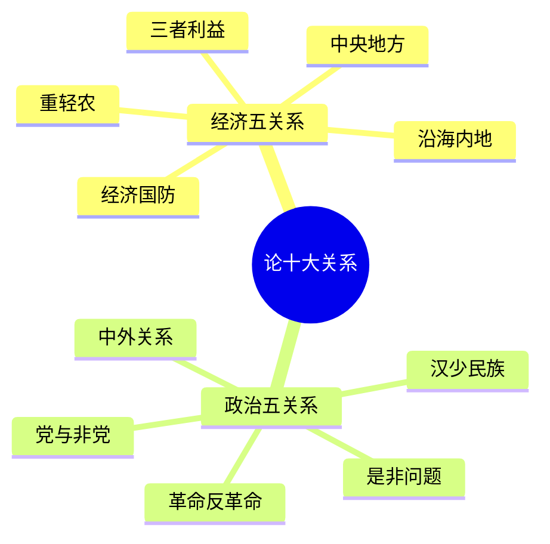
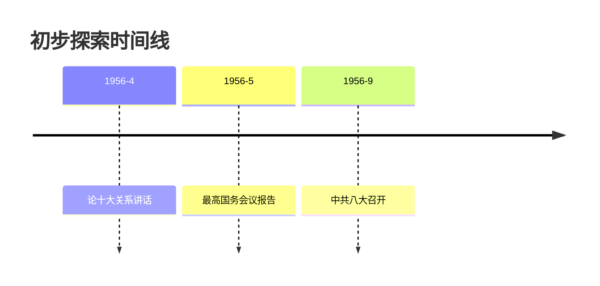

# 《论十大关系》等对适合中国特点的社会主义建设道路的初步探索

## 它是什么

《论十大关系》是 1956 年毛泽东在社会主义改造基本完成后，对**适合中国特点的社会主义建设道路**进行初步探索的标志性文献。讲话围绕==十对关系==展开，前五对主要讲经济问题，后五对主要讲政治问题：

| 类别 | 十大关系 |
|---|---|
| 经济（前五） | 重工业和轻工业、农业；沿海工业和内地工业；经济建设和国防建设；国家、生产单位和生产者个人；中央和地方 |
| 政治（后五） | 汉族和少数民族；党和非党；革命和反革命；是非；中国和外国 |

==核心思想==：以苏联经验为鉴戒，==调动一切积极因素==为社会主义事业服务，而不是照搬别国模式。

## 为什么需要

1956 年苏共二十大暴露了苏联模式的弊端，国内社会主义改造已基本完成。这时候必须回答一个问题：**中国的社会主义建设该怎么走？**《论十大关系》就是对这个问题的第一次系统回答，提出了探索中国自己建设道路的任务。

## 怎么做——两次会议的推进

- **1956 年 4 月/5 月**：毛泽东分别向中央政治局、最高国务会议作《论十大关系》报告。
- **1956 年 9 月**：中共八大正确分析主要矛盾，把==集中力量发展社会生产力==定为根本任务。

> [!IMPORTANT]
> 中共八大指出：社会主义制度已基本建立，国内主要矛盾是==人民对经济文化迅速发展的需要同当前经济文化不能满足人民需要之间的矛盾==，主要任务是集中力量发展社会生产力、实现国家工业化。

## 和相近概念的区别

| 文献/时期 | 侧重点 |
|---|---|
| 《论十大关系》 | 调动积极因素、处理好十对关系，重在经济政治**方针** |
| 中共八大 | 明确主要矛盾与根本任务，重在**路线决议** |
| 后期“大跃进”/人民公社 | 出现浮夸风、“共产风”，偏离了实事求是 |

> [!WARNING]
> 判断题常见混淆：“大跃进”是人民公社时期产生的浮夸风、“共产风”——此说法==正确==。但它属于探索中的**曲折**，不是《论十大关系》提出的内容。

## 常见的坑

- 坑一：把十大关系全当成经济问题。==后五对是政治关系==。
- 坑二：误以为八大时国内主要矛盾仍是工人阶级与资产阶级的矛盾——那是社会主义改造完成**前**的情况。
- 坑三：以为毛泽东思想的出发点是本本或经验，实际上==实事求是是毛泽东思想的出发点和根本点==。

> [!TIP]
> 记忆口诀：“前五经济后五政，调动因素是灵魂；八大矛盾已转变，发展生产力是本。”

## 做对一道题

**判断**：“实事求是是毛泽东思想的出发点和根本点。”  
分析：毛泽东思想的活的灵魂包括实事求是、群众路线、独立自主，其中==实事求是==是出发点和根本点。故本题答案为 **√**。
