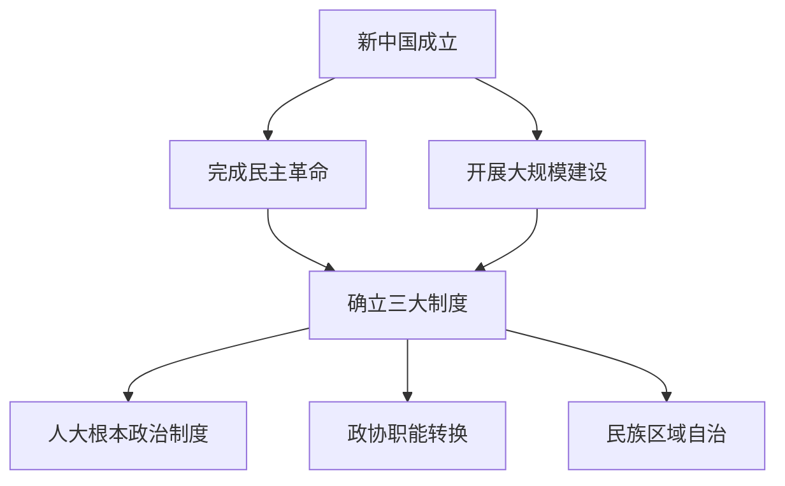

# 中华人民共和国成立（一唱雄鸡天下白）的伟大意义

## 它是什么与为什么需要

1949年10月1日下午3时，毛泽东在天安门广场庄严宣告中央人民政府成立。这不仅仅是一场庆典，更是==中国历史新纪元的开端==。

> [!IMPORTANT]
> 核心意义：标志着中国人民从此站起来了，真正成为国家的主人，为当代中国发展进步奠定了根本政治前提和制度基础。

为什么这一时刻如此关键？新中国成立前，中国面临资产阶级糖衣炮弹、民主革命遗留任务及民生百废待兴等严峻挑战。开国大典的举行，意味着党领导人民成功应对了这些挑战，完成了从“打天下”到“治天下”的历史性跨越，使中华民族摆脱了近代以来的屈辱命运，开启了实现伟大复兴的征程。

## 怎么做与制度奠基

新中国的成立并非终点，而是社会主义制度建设的起点。从1949年到1956年底，党和国家通过一系列举措巩固了新生政权：

- **人民代表大会制度**：第一届全国人大一次会议制定首部宪法，确立了这一==根本政治制度==。
- **中国共产党领导的多党合作和政治协商制度**：政协二届通过新章程，标志着人民政协实现了职能转换。
- **民族区域自治制度**：在各民族平等团结基础上进一步确立，保障了少数民族当家作主的权利。

> [!TIP]
> 记忆口诀：一部宪法定根本，政协转型聚人心，民族自治保平等，三大制度筑基石。

## 易混辨析与常见误区

复习时需注意区分“新中国成立”与后续历史节点的逻辑关系，避免张冠李戴。

| 对比维度 | 中华人民共和国成立（1949） | 中国梦提出（2012） |
| :--- | :--- | :--- |
| 历史定位 | 开辟新纪元，站起来 | 全面建成小康社会决定性阶段 |
| 核心内涵 | 国家独立、人民当家作主 | 国家富强、民族振兴、人民幸福 |
| 奋斗目标 | 建立社会主义基本制度 | “两个一百年”奋斗目标 |

> [!WARNING]
> 切勿将“文化大革命”（1966-1976）的错误与新中国成立的意义混淆。“文革”是全局性“左”倾错误，而新中国成立及其后的制度建设是正确的、具有奠基性的。

## 真题示例与解题验证

以课件中的选择题为例：

**题目**：1949年10月1日，开国大典在天安门广场隆重举行，三十万人参加庆典，（ ）向世界庄严宣布“中华人民共和国中央人民政府今天成立了！”
a. 毛泽东 b. 周恩来 c. 刘少奇 d. 朱德

**解析**：本题考查开国大典的核心史实。根据史料记载，1949年10月1日下午3时，==毛泽东==主席在天安门城楼上向全世界庄严宣告中华人民共和国中央人民政府成立。这是《四史》课程中关于新中国成立最基础的知识点，需准确记忆时间（下午3时）、人物（毛泽东）及宣告内容。

> [!NOTE]
> 延伸考点：五星红旗设计者曾联松是南京大学校友；中共中央1949年3月23日从西柏坡起程前往北平，这些细节也常作为选择题出现，需结合“进京赶考”背景理解。
