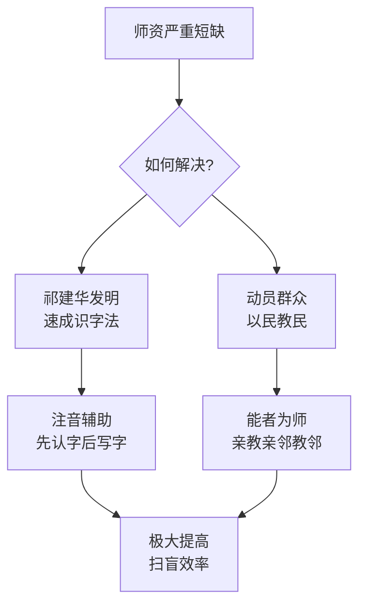

# 新中国成立初期的扫盲运动与文化普及（知识星火满天涯）

## 知识星火满天涯——扫盲运动与文化普及

新中国成立之初，国家建设面临的最大“拦路虎”之一便是国民文化素质的低下。==文盲率高达 80%==，这意味着绝大多数劳动者无法阅读技术手册、理解政策文件，严重制约了工业化进程与社会治理。

> [!IMPORTANT]
> 核心数据：1949 年建国初期，全国人口中文盲率约为 **80%**。这是党史中关于社会改造的重要背景数据。

### 为什么需要扫盲？

想象一下，如果工厂里的工人看不懂操作说明书，农村的农民读不懂农业技术推广单，国家的现代化蓝图如何落地？扫盲不仅是教育问题，更是==政治任务与经济基础==。它旨在将“人力”转化为“人才”，为社会主义建设提供智力支持。

### 怎么做：群众智慧的爆发

面对师资极度短缺的现实，党和政府没有等待正规师范体系的完善，而是发动了群众性的创新。

#### 1. 技术突破：速成识字法
西南军区文化干事祁建华发明的==速成识字法==是这一时期的典型代表。该方法利用注音字母作为辅助工具，帮助学员快速掌握常用字的读音和字形，实现了从“死记硬背”到“规律识字”的转变。

#### 2. 组织形式：以民教民
为了解决老师不够的问题，提倡==“以民教民，能者为师”==。只要认识几百个字，就可以教不认识字的人。这种“十字先生”、“百字先生”的现象，形成了全社会互帮互助的学习网络。

> [!TIP]
> 记忆技巧：扫盲运动的核心特征是**“快”**（速成法）和**“广”**（群众性）。记住“祁建华”和“80%”这两个关键锚点。

### 常见误区与辨析

在复习时，容易将扫盲运动与其他社会改造运动混淆。请注意以下区别：

| 维度 | 扫盲运动 | 院系调整 (1952) |
| :--- | :--- | :--- |
| **主要对象** | 广大工农群众 | 高等教育体系 |
| **核心目标** | 消除文盲，普及基础文化 | 培养专门技术人才 |
| **关键人物/事件** | 祁建华、速成识字法 | 模仿苏联模式 |
| **易错点** | 勿认为仅靠学校教师 | 勿认为完成于 1953 年 |

> [!WARNING]
> 高频陷阱：关于 1952 年院系调整，常考判断题称其“发生与完成于 1952 年”。实际上，调整是一个持续过程，虽以 1952 年为大高潮，但不能简单表述为仅在当年完成。而扫盲运动则是一个长期的群众运动，贯穿整个五十年代。

### 关联考点：医疗卫生与社会风貌

扫盲运动往往与改善民生同步进行。毛泽东诗词《七律二首·送瘟神》的创作背景，正是江西省余江县消灭了==血吸虫病==。这反映了新中国在提升人民身体素质和文化素质方面的双重努力。

> [!NOTE]
> 延伸思考：扫盲运动不仅提高了识字率，更增强了民众的国家认同感和政治参与能力，是党密切联系群众的具体体现。
