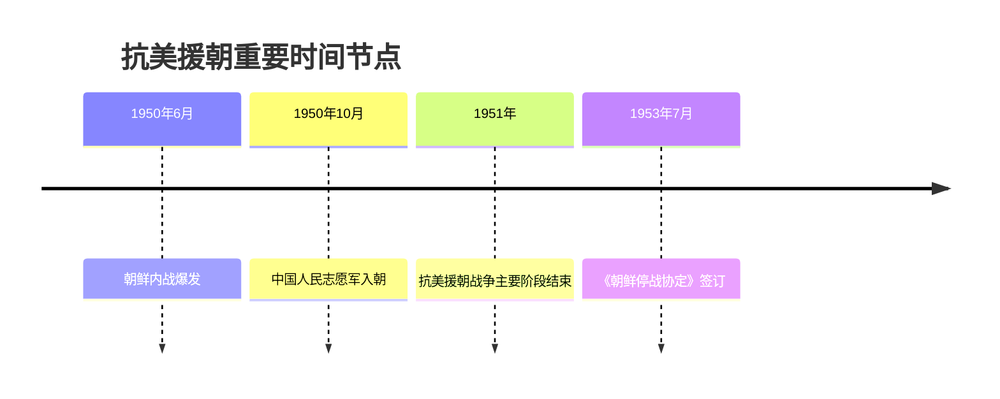
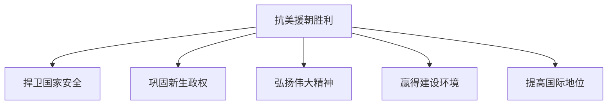

# 抗美援朝战争的决策、过程与历史意义（一条大河波浪宽）

抗美援朝战争是新中国成立初期为保家卫国、援助朝鲜人民而进行的正义战争，是中国共产党领导中国人民取得的一次伟大胜利。它既发生在国内政权巩固、经济恢复的紧要关头，也发生在朝鲜内战爆发、美国武装干涉并威胁中国安全的复杂背景下。

## 历史背景与出兵必要性

朝鲜内战突然爆发后，美国政府操纵联合国安理会，派遣第七舰队侵入台湾海峡，并组织“联合国军”越过“三八线”、直逼鸭绿江，严重威胁中国安全。与此同时，新中国还面临着巩固政权、恢复经济和建设国家的重要任务。

面对美国扩大干涉和边境安全受到严重威胁的情况，中国人民志愿军跨过鸭绿江，赴朝作战。这不是普通的境外战争，而是为保卫新中国安全、支援朝鲜人民、维护亚洲和平进行的正义战争。

## 决策与战争过程

中国共产党和中央人民政府经过慎重研究，作出抗美援朝、保家卫国的战略决策。1950年10月，中国人民志愿军在彭德怀司令员率领下入朝，与朝鲜人民并肩作战。

战争大致经历了四个阶段：

| 阶段 | 主要特点 |
|---|---|
| 运动战阶段 | 志愿军利用朝鲜山地和有利地形，连续组织大规模战役，迫使美军后退 |
| 阵地战阶段 | 双方在“三八线”附近形成长期对峙，战争进入相持阶段 |
| 反击阶段 | 中国人民志愿军以较大兵力实施战役性反击，歼灭和击溃大批敌军 |
| 谈判与停战阶段 | 在中朝共同努力下，经过谈判和签字，1953年正式停战 |

战争期间，涌现出黄继光、邱少云、杨根思等英雄人物。1952年10月的上甘岭战役中，黄继光舍身堵枪眼；邱少云在潜伏时为避免暴露目标，承受烈火焚烧而壮烈牺牲。

## 与相关概念的区分

| 概念 | 含义 |
|---|---|
| 抗美援朝战争 | 新中国成立初期援助朝鲜、抵抗美国侵略的正义战争 |
| 抗美援朝运动 | 全国人民在政治、经济、军事等方面支援前线、参军报国的社会动员 |
| “联合国军” | 美国操纵并组织的武装力量，其中包含多国军队，不能等同于真正维护国际秩序的联合国部队 |
| 上甘岭战役 | 抗美援朝战争中的著名战役，1952年10月发生，英雄黄继光牺牲于此役 |

## 历史意义

抗美援朝战争的胜利，是中国人民站起来后屹立东方的宣言书，是中华民族走向伟大复兴的重要里程碑。它抵御了帝国主义侵略扩张，捍卫了新中国安全，支援了朝鲜人民，并为国内经济建设赢得了相对稳定的环境。

抗美援朝战争的胜利，使中国人民和中华民族 tremendously 迸发了不可战胜的伟大英雄主义精神，为新中国的安全稳定、和平发展奠定了基础。抗美援朝战争的胜利，使新中国站稳了脚跟。这句话中的“站稳脚跟”，主要是指：新生人民政权得到巩固，国家安全得到保障，中国人民在国际社会中的地位和影响力显著提高。

> [!IMPORTANT]
> 核心结论：抗美援朝战争是新中国成立初期为保家卫国、援助朝鲜而进行的正义战争。其胜利使新中国站稳了脚跟，为国家建设赢得了相对稳定的外部环境。

## 常见考点与易错点

1. **战争周年**：2020年是抗美援朝出国作战70周年。
2. **第一部故事片**：我国第一部关于抗美援朝的故事片是《上甘岭》。
3. **英雄对应**：黄继光在上甘岭战役中舍身堵枪眼；邱少云以严格纪律和巨大牺牲成就胜利；杨根思思是抗美援朝英雄；董存瑞是解放战争时期舍身炸碉堡的英雄。
4. **主题歌曲**：《我的祖国》是电影《上甘岭》的主题曲。
5. **历史背景**：朝鲜内战爆发、美国第七舰队侵入台湾海峡、“联合国军”越过“三八线”直逼鸭绿江，以及国内巩固政权、恢复经济的任务，都是抗美援朝战争的重要背景。

> [!TIP]
> 记忆口诀：**抗美援朝保家国，志愿军跨鸭绿江；上甘岭战役英雄赞，黄继光堵枪眼；一九五三签停战，胜利站稳新脚跟。**
