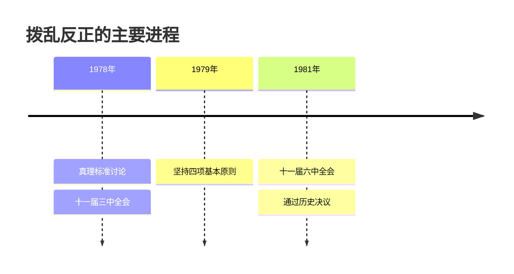

# 《关于建国以来党的若干历史问题的决议》与拨乱反正任务的完成

《关于建国以来党的若干历史问题的决议》是1981年6月党的十一届六中全会审议通过的重要历史文献。它的核心任务，是在改革开放起步后，对新中国成立以来党的重大历史问题作出科学总结，特别是正确评价毛泽东的历史地位、坚持和发展毛泽东思想，从而完成党在指导思想上的拨乱反正。

## 为什么需要这份决议

“文化大革命”结束后，党既要纠正“左”的错误，又要防止借纠正错误否定党的领导和社会主义制度。1978年开展的真理标准问题大讨论，推动了思想解放；党的十一届三中全会实现工作中心转移，作出改革开放的历史性决策，开启了拨乱反正和现代化建设的新时期。

但历史转折还面临一个关键问题：怎样既彻底否定“文化大革命”和“无产阶级专政下继续革命的理论”，又维护毛泽东的历史地位？如果评价失当，就可能造成思想混乱，影响全党全国团结。《历史决议》正是为了==统一全党认识、总结历史经验、明确前进方向==而制定的。

## 决议怎样评价历史

《历史决议》坚持实事求是、一分为二，既指出毛泽东晚年的严重错误，又强调他的历史功绩是第一位的，错误是第二位的；明确毛泽东是伟大的马克思主义者、伟大的无产阶级革命家、战略家和理论家。

同时，决议把==毛泽东思想==同毛泽东晚年的错误区分开来。毛泽东思想是马克思列宁主义在中国的运用和发展，是被实践证明了的关于中国革命和建设的正确理论原则和经验总结，是中国共产党集体智慧的结晶，必须继续坚持和发展。因此，不能因毛泽东晚年犯错误而否定毛泽东思想，也不能把毛泽东的所有言论都当作不可改变的教条。

> [!IMPORTANT]
> 高频结论：==党的十一届六中全会通过《历史决议》，标志着党在指导思想上的拨乱反正胜利完成。==

## 拨乱反正还包括什么

《历史决议》的通过是完成标志，但拨乱反正不是只靠一份文件完成的，还包括多方面工作：

| 方面 | 主要内容 |
|---|---|
| 思想路线 | 开展真理标准讨论，恢复实事求是的思想路线 |
| 政治原则 | 发表《坚持四项基本原则》，明确共同政治基础 |
| 组织与社会关系 | 大规模平反冤假错案，清理和调整社会关系 |
| 历史总结 | 通过《历史决议》，科学评价重大历史问题 |

> [!NOTE]
> 四项基本原则是全党团结和全国各族人民团结的共同政治基础，即坚持社会主义道路、坚持人民民主专政、坚持中国共产党的领导、坚持马克思列宁主义毛泽东思想。

## 易混点与答题示例

> [!WARNING]
> 不要把会议和文件张冠李戴：十一届三中全会主要对应“伟大历史转折、改革开放”；十一届六中全会主要对应“通过《历史决议》、完成指导思想拨乱反正”。

**例题：**审议通过《关于建国以来党的若干历史问题的决议》，肯定毛泽东历史地位和毛泽东思想的会议是（　）。

A. 党的十一届三中全会  
B. 党的十一届六中全会  
C. 党的十二大  
D. 党的十四大  

**答案：B。** 判断依据是“会议—文件—意义”的对应关系：1981年十一届六中全会通过《历史决议》，完成指导思想上的拨乱反正。

> [!TIP]
> 记忆口诀：==三中全会开新局，六中全会作决议；科学评价毛泽东，拨乱反正告完成。==
