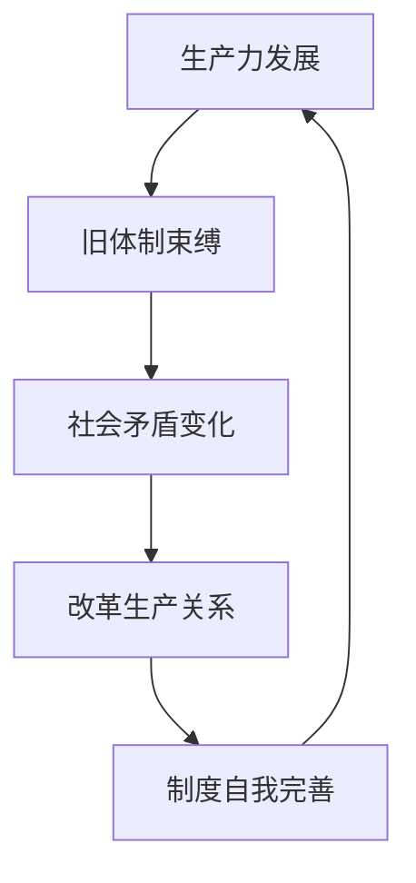
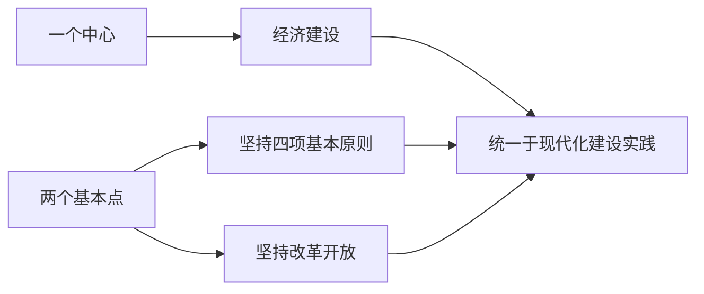

# 改革是社会主义发展的内在要求

## 先想一个问题

社会主义制度建立后，是不是就“躺着等共产主义”了？

不是。制度本身不会自动解决一切问题。生产力还在发展，社会矛盾还在变化，国际上还有竞争与压力。如果体制机制僵化，就会束缚生产力、压抑社会活力。所以：

> [!IMPORTANT]
> ==改革是社会主义发展的内在要求==，是社会主义制度的自我完善和发展，不是改旗易帜。

这里的关键词是“内在要求”：不是外部强加的，而是社会主义自身向前走必须做的事。

---

## 改革为什么是“内在要求”

可以从三个层面理解：

| 层面 | 为什么需要改革 |
|------|----------------|
| 生产力层面 | 旧的体制机制会束缚生产力发展，不改革就停滞 |
| 社会矛盾层面 | 矛盾不断变化，需要通过改革调整生产关系、上层建筑 |
| 制度层面 | 社会主义制度本身有一个不断完善的过程 |

所以改革不是“推翻制度”，而是==在坚持社会主义基本制度的前提下，调整具体体制==。

---

## 一个容易混的点：改革 ≠ 改向

> [!WARNING]
> 改革的对象是“体制”，不是“制度”。

- **社会主义基本制度**：公有制为主体、党的领导、人民民主专政等——必须坚持。
- **具体体制**：经济体制、科技体制、教育体制等——可以改、必须改。

如果用一句话记：

> [!TIP]
> **“改体制不改制度，改具体不改根本。”**

这和“复古”“坚守不变”完全不同，更不是改旗易帜的“改向”。

---

## 为什么改革开放是“决定中国命运的一招”

改革开放前，我国经济体制高度集中，企业没有活力，人民生活改善缓慢。1978 年之后，通过改革：

- 农村实行家庭联产承包责任制；
- 城市推进经济体制改革，增强企业活力；
- 逐步建立社会主义市场经济体制。

1984 年《关于经济体制改革的决定》提出若干重大举措，但==没有提出“以非公有制经济为主体”==。我国的基本经济制度是：==公有制为主体、多种所有制经济共同发展==。

> [!CAUTION]
> 如果题目问“《关于经济体制改革的决定》中提出的重大改革举措不包括”，见到“以非公有制经济为主体”就要警惕——这是把“主体”位置放错了。

---

## 一个算对了的例子（真题思路）

**选择 1**  

（\ \ \ \ ）是社会主义发展的内在要求。  
A. 沿袭　B. 复古　C. 坚守　D. 改革  

答案：**D**。

理由：改革是社会主义制度的自我完善和发展，是社会主义发展的==内在要求==；“沿袭”“复古”“坚守”都强调不变，与社会主义前进方向不符。

---

## 联系党的基本路线

党的基本路线的核心内容是“一个中心、两个基本点”：

其中“一个中心”是==以经济建设为中心==。改革就是为了解放和发展生产力，核心落脚点也在经济建设上。
