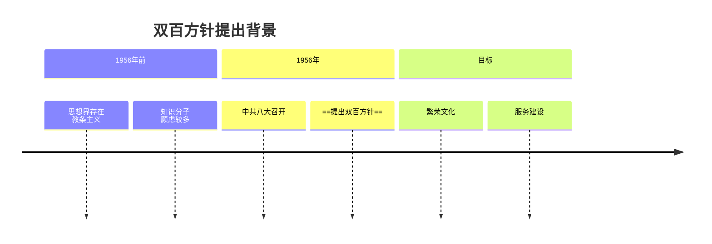

# 百花齐放、百家争鸣方针与文化事业的繁荣

# 百花齐放、百家争鸣方针与文化事业的繁荣

## 它是什么：双百方针的内涵

“双百”方针即 **==百花齐放、百家争鸣==**。1956年，毛泽东正式提出这一指导科学和文化工作的基本方针。
- **百花齐放**：针对艺术领域，鼓励不同形式和风格的艺术自由发展。
- **百家争鸣**：针对学术领域，允许不同学派和观点自由争论。

> [!IMPORTANT]
> 核心定位：它是党领导社会主义文化建设的 **==基本方针==**，旨在调动知识分子积极性，繁荣社会主义文化。

## 为什么需要：历史背景与目的

新中国成立初期，为了迅速改变经济文化落后面貌，迫切需要调动一切积极因素。
- **破除教条**：打破对苏联模式的盲目崇拜和思想僵化。
- **激发活力**：解决“如何建设社会主义文化”的问题，促进科学与艺术创新。

## 怎么做：实践与成就

在“双百”方针指引下，我国文化事业出现短暂繁荣，涌现出一批经典作品。

> [!TIP]
> 记忆口诀：**三红一创青山保**。这是该时期红色经典小说的代表。

| 类别 | 代表作品/现象 | 备注 |
| :--- | :--- | :--- |
| 小说 | 《红岩》《红日》《红旗谱》《创业史》 | 合称“三红一创” |
| 电影 | 《红色娘子军》《英雄儿女》 | 鼓舞人心 |
| 戏剧 | 老舍《茶馆》 | 艺术高峰 |

**算对了的例子**：
回顾考题中关于“红色经典”的考察：
> 红色经典小说“三红一创”指的是？
> 答案：**ABCD**（《红岩》《红日》《红旗谱》《创业史》）。
> *解析*：这些作品正是在“双百”方针鼓励下，作家深入生活、大胆创作的成果，体现了革命文化与社会主义先进文化的熔铸。

## 常见误区与辨析

> [!WARNING]
> 易错点：**“双百”不是无原则的自由化**。
> 它坚持的前提是：**以马克思主义为指导**，坚持为人民服务、为社会主义服务（二为方向）。

| 概念 | 区别要点 |
| :--- | :--- |
| **双百方针** | 侧重 **方法**：如何处理艺术/学术中的矛盾，鼓励多样性。 |
| **二为方向** | 侧重 **目的**：文化为谁服务（人民、社会主义）。 |
| **文化自信** | 侧重 **心态**：对自身文化价值的肯定（如通过仪式传递）。 |

> [!NOTE]
> 延伸辨析：考题中提到“设立纪念日、重温入党誓词”直观呈现的是 **==文化自信==**（选项A），而非直接考查双百方针，但二者同属中国特色社会主义文化建设范畴。双百方针是手段，文化自信是结果之一。

## 总结

中国特色社会主义文化源自中华优秀传统文化，熔铸于革命文化和社会主义先进文化。坚持“双百”方针，就是要 ==创造性转化、创新性发展==，推动精神文明与物质文明协调发展。
