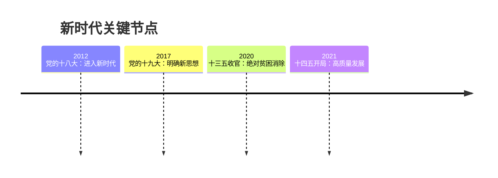

# 新时代中国特色社会主义取得的历史性伟大成就

## 新时代中国特色社会主义的历史性成就

先想一个问题：为什么“十四五”规划不是从 2020 年而是从 **2021 年**才开始实施？这其实涉及五年规划的编制规律——“十四五”覆盖 2021—2025 年，而 2020 年正处于“十三五”收官与规划编制的交叉期。从这个细节出发，可以看到进入新时代后，国家发展已经从“规模扩张”转向“质量与结构并重”。

### 成就的四个观察维度

理解“历史性成就”，不能只背条目。建议从 **经济、民生、治理、国际地位** 四个维度建立框架：

| 维度 | 标志性成就 | 关键判断点 |
|---|---|---|
| 经济 | 成为世界第二大经济体；解决社会主义与市场经济结合的世界性难题 | ≠ 世界第一 |
| 民生 | 历史性解决绝对贫困问题；以人民健康为中心 | 健康是发展的基础条件 |
| 治理 | 反腐败零容忍；全面从严治党 | 零容忍 ≠ 阶段性严打 |
| 国际 | 中国经济成为世界经济的发动机和稳定器 | 注意“稳定器”而非“主导者” |

> [!IMPORTANT]
> ==新时代是从 2012 年党的十八大开始的==，这是判断“进入新时代”时间节点的核心依据。中国特色社会主义新时代不是从十九大才开始的。

### 一条时间线：从十八大到十四五

### 易错辨析

> [!WARNING]
> **“国内生产总值世界第一”是错误说法。** 中国是世界第 **二** 大经济体（按 GDP 总量），改革开放的成效中不包括“世界第一”。题目中若出现“第一”“主导”“领先全球”这类绝对化表述，要格外警惕。

另一个高频陷阱在“健康中国”部分：

> [!TIP]
> 记忆口诀：**“健、基、共、标”** ——健康是促进人的全面发展的**必**然要求、是经济社会发展的**基**础条件、是广大群众的**共**同追求、是民族昌盛和国家富强的**标**志。四个选项通常同时正确。

### 结合真题的“算对了”示例

以选择题 5 为例，正确选项是 **ABCD**。判断逻辑不是逐条背句子，而是抓“健康”这个核心词与四个维度的对应关系：

- “人的全面发展”对应 **A**（必然要求）；
- “经济社会发展”对应 **B**（基础条件）；
- “广大人民群众”对应 **C**（共同追求）；
- “民族昌盛、国家富强”对应 **D**（重要标志）。

四个选项分别从**个体发展、经济基础、社会共识、国家层面**展开，不存在内涵重复，因此全选。

> [!NOTE]
> 这类题的错误选项通常会用“唯一”“第一”“根本”等词制造绝对化陷阱，或者把“基础条件”偷换成“充分条件”“决定因素”。

最后回到判断题 42：“中华民族的伟大复兴已经进入了不可逆转的历史进程。”这判断为 **正确**。它的依据正是新时代取得的一系列历史性成就——脱贫攻坚、制度完善、综合国力提升，使复兴具备了不可逆转的**物质基础与制度保障**。理解这一点，比单纯记住“√”更有用。
