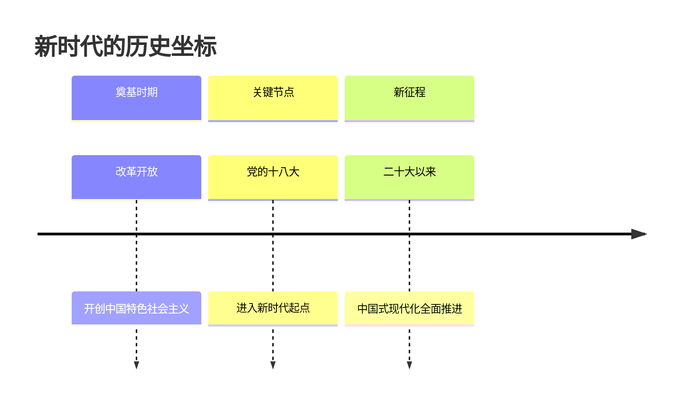

# 深刻理解中国特色社会主义进入新时代的内涵和意义

## 什么是“新时代”

当我们谈论中国特色社会主义进入新时代时，你是否思考过：这个“新”究竟是以什么为标志？是单纯的时间推移，还是社会发展的质变？

> [!IMPORTANT]
> ==中国特色社会主义进入新时代，是我国发展新的历史方位。== 它并非泛指时间概念，而是特指党的十八大以来，党和国家事业取得历史性成就、发生历史性变革后所处的特定发展阶段。

从社会主义发展史的宏观视角看，这是社会主义实践探索的新境界。它不仅意味着中国自身的发展跃升，更标志着科学社会主义在21世纪的中国焕发出强大生机活力。

## 为什么需要把握其内涵与意义

理解新时代，不能仅停留在口号层面，而应明确其解决的核心问题。习近平新时代中国特色社会主义思想明确回答了==坚持和发展什么样的中国特色社会主义、怎样坚持和发展中国特色社会主义==这两个重大时代课题。

> [!NOTE]
> 结合真题（多选17）可知，新时代的理论成果聚焦于“坚持和发展中国特色社会主义”，而非泛泛回答“怎样建设社会主义”或“怎样建设党”。后者分别属于邓小平理论和“三个代表”重要思想的重点范畴。

这一判断的现实依据在于：我国社会主要矛盾已转化为人民日益增长的美好生活需要和不平衡不充分的发展之间的矛盾。同时，中国作为拥有5000多年文明史和13亿多人口的东方大国，其成功实践对世界社会主义发展态势产生了重大影响，极大鼓舞了人们对社会主义的信心。

## 如何准确区分相关概念

复习中常将“新时代”与其他历史阶段或理论主题混淆，需特别注意辨析：

| 对比维度 | 新时代 | 新时期 | 新纪元 |
| :--- | :--- | :--- | :--- |
| **起始标志** | 党的十八大（2012年） | 十一届三中全会（1978年） | 新中国成立/十月革命 |
| **核心任务** | 强国建设、民族复兴 | 改革开放、解放生产力 | 建立社会主义制度 |
| **理论成果** | 习近平新时代中国特色社会主义思想 | 邓小平理论等 | 马克思列宁主义 |

> [!WARNING]
> 判断题33明确指出：“从2012年党的十八大开始，中国特色社会主义进入发展的新时代。”切勿将“新时代”起点误记为十九大或二十大。

## 常见误区与应试要点

> [!CAUTION]
> “新时代”不等于“新发展阶段”。“十四五”规划自2021年起实施（选择3），属于新时代中的具体发展阶段，二者是整体与局部的关系，不可等同替换。

此外，必须牢记==中国共产党的领导是中国特色社会主义最本质的特征==（选择4）。这是理解新时代一切成就和变革的根本政治前提。脱离党的领导谈新时代，就偏离了社会主义发展史的基本立场。

> [!TIP]
> 记忆口诀：十八开启新时代，本质特征党领导；两个课题要分清，世界意义信心增。
