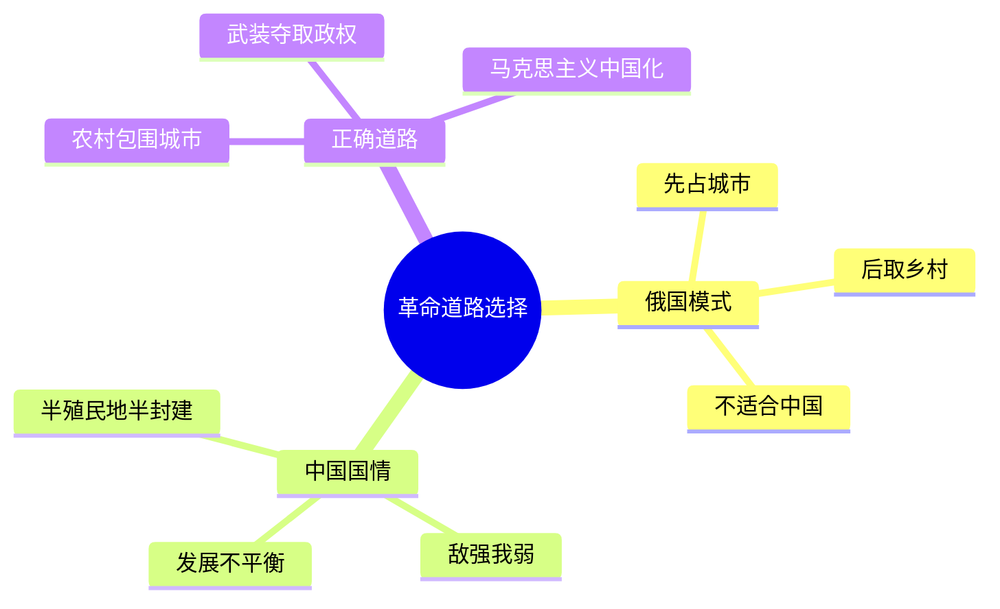

# 农村包围城市、武装夺取政权的新民主主义革命正确道路

## 是什么：中国革命的独特道路

==农村包围城市、武装夺取政权==是中国共产党在土地革命战争时期探索出的新民主主义革命正确道路。它不同于俄国十月革命“先占城市后取乡村”的模式，而是根据中国半殖民地半封建社会的国情，确立了==经过长期武装斗争，先占乡村，后取城市，最后夺取全国胜利==的战略路径。

> [!IMPORTANT]
> 核心定义：以农村为工作重心，建立根据地，通过“工农武装割据”积蓄力量，最终夺取全国政权。

## 为什么需要：国情决定的必然选择

为什么不能照搬俄国经验？因为近代中国政治经济发展极不平衡，敌人力量在城市强大而在农村薄弱。

毛泽东在《中国的红色政权为什么能够存在?》等文章中深刻分析指出，中国革命的==长期性==和==不平衡性==决定了必须走这条独特道路。这不仅是军事战略的调整，更是马克思主义基本原理同中国具体实际相结合的光辉典范。

## 怎么做：工农武装割据的实践

这一道路的形成经历了从实践到理论的升华过程：

1.  **起步**：1927年秋收起义失败后，毛泽东率部上井冈山，创建第一个农村革命根据地。
2.  **理论初步形成**：撰写《井冈山的斗争》《星星之火，可以燎原》，提出==“工农武装割据”==思想。
3.  **成熟确立**：1938年六届六中全会，毛泽东明确指出共产党任务不是先占城市，而是走相反道路。

> [!TIP]
> 记忆线索：井冈山（起点）→ 三篇文章（理论雏形）→ 陕北分析（丰富战略）→ 六届六中全会（正式确立）。

## 常见误区与辨析

| 维度 | 俄国十月革命道路 | 中国革命道路 |
| :--- | :--- | :--- |
| **进攻方向** | 城市中心论 | 农村包围城市 |
| **主要形式** | 城市武装起义 | 长期游击战争 |
| **理论依据** | 马克思主义经典论述 | 马克思主义中国化 |

> [!WARNING]
> 易错点：不要混淆“工农武装割据”与“农村包围城市”。前者是后者的基础和内容（武装斗争、土地革命、根据地建设三者结合），后者是整体战略方向。

## 典型例题解析

回顾课件中的选择题：

> 【单选题】毛泽东在自己的著作（）中提出“没有调查就没有发言权”。
> A. 《实践论》 B. 《矛盾论》 C. 《反对本本主义》 D. 《论持久战》

**解析**：答案选 **C**。虽然本题直接考查的是调查研究，但它反映了确立正确革命道路的方法论基础——==实事求是==。正是通过深入调查中国国情（如《反对本本主义》所倡导），党才摆脱了教条主义束缚，找到了农村包围城市的正确道路。若只背诵俄国经验而不调查中国实际，就无法理解为何要“走相反的道路”。
