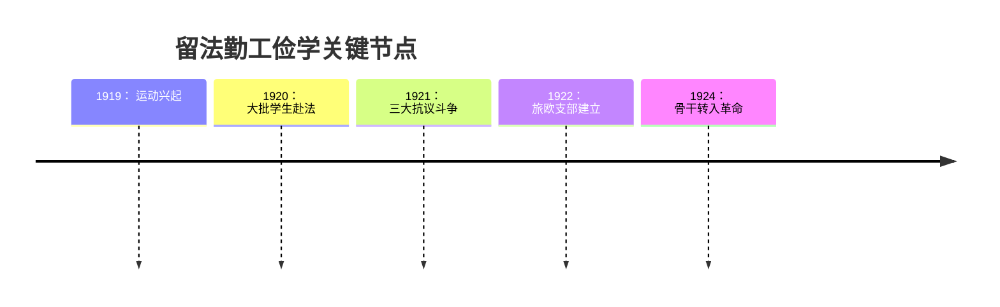

# 早期共产党人的旅法岁月与理想追求

## 旅法岁月里，他们如何追理想？

留法勤工俭学运动是中共党史上一段特殊的篇章。一批有志青年在五四运动前后远赴法兰西，在打工与求学中观察世界、比较思潮、选择信仰，最终为中国的革命事业锻造了一批骨干力量。理解这段历史，关键在于抓住三个问题：**为什么去法国？去了之后经历了什么？这段经历对党意味着什么？**

### 为什么是法国？

辛亥革命后，中国知识界掀起“向西方学习”的热潮。法国之所以成为重要目的地，主要有三个原因：

| 因素 | 具体内容 |
|------|----------|
| 思想文化 | 法国是启蒙运动和巴黎公社的故乡，社会主义、无政府主义等思潮活跃 |
| 教育模式 | 李石曾、蔡元培、吴玉章等人倡导“勤于做工、俭以求学”，留学费用远低于英美 |
| 现实需求 | 一战后的法国劳动力短缺，大量工厂需要工人，青年可通过做工自筹生活费用 |

> [!WARNING]
> 考试中容易混淆的是“劳动力短缺”——它是**提供了半工半读的现实条件**，但**不是青年赴法的根本动因**。题目中“法国劳动力短缺”作为“求学原因”的选项是**错误**的。

留法勤工俭学运动的直接推动者是蔡元培、李石曾、吴玉章等人，蔡和森当时是辗转赴法的学生，后来成为运动中的骨干，但**不属于运动的倡导者和发起者**。

### 抵达法国后：理想与现实的碰撞

赴法勤工俭学群体规模大、来源广、年龄跨度大，有中学生、师范生、工人、教员，也有年过四旬的“老学生”。他们大多怀揣救国理想，但很快遭遇了现实困境：华法教育会经费断裂、法国经济衰退导致失业潮、部分学生被迫住进帐篷、靠救济度日。

正是这种困境催化了政治觉醒。1921 年，留法学生先后发动了“二·二八运动”“拒款运动”“进占里昂中法大学运动”。在这些斗争中，蔡和森、周恩来、赵世炎、邓小平、陈毅等人逐渐认识到：没有社会制度的根本变革，单纯的“工业救国”“教育救国”走不通。

1922 年，旅欧中国少年共产党在巴黎成立，后改称旅欧中国共产主义青年团，中共旅欧支部也随之建立。这批青年在法国完成了从“求学”到“求真理”再到“干革命”的三级跳跃。

### 从旅法岁月看青年与党的关系

旅法群体中走出了一批对中国革命影响深远的人物：周恩来、邓小平、蔡和森、向警予、陈毅、赵世炎、聂荣臻等。他们的共同特征是：在现实实践中完成了信仰选择，而非书斋里的空想。

> [!IMPORTANT]
> ==旅法勤工俭学运动的核心历史意义在于：它为中国革命准备了一批兼具理论素养与实践经验的干部队伍。==

考试中另一个高频考点是邓恩铭。需注意区分：邓恩铭**没有赴法勤工俭学**，他是在山东济南成长起来的革命者，中学时期参与发起济南共产党早期组织，出席了中共一大，大革命时期领导了胶济铁路大罢工。山海关铁路工人大罢工的领导者是王尽美等人，==不是邓恩铭==。

> [!NOTE]
> 延伸辨析：邓恩铭与王尽美同属山东早期党组织，都是中共一大代表。王尽美参与领导了山海关铁路工人大罢工，邓恩铭则主要活动于山东本地的工人运动，二者容易混淆。

### 算对了的例子

**多选题**：以下关于革命烈士邓恩铭的表述，正确的有（ ）。

- A. 在中学时期就参与发起了济南共产党早期组织 ✓
- B. 参加了中共一大 ✓
- C. 大革命时期领导了胶济铁路大罢工 ✓
- D. 中共一大后领导了山海关铁路工人大罢工 ✗（王尽美领导，与邓恩铭无关）

**答案：ABC。**

**判断**：“中国共产党必须始终代表广大青年、赢得广大青年、依靠广大青年。”这是从旅法青年成长经历中提炼出的组织逻辑——青年马克思主义者在实践中被党识别、培养和依靠，党的事业也因青年注入而薪火相传。✓
