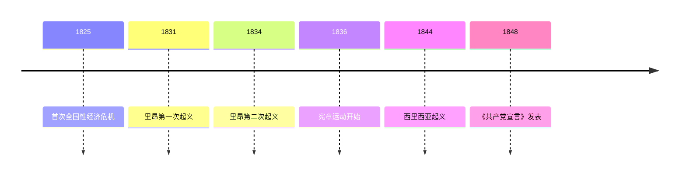

# 资本主义社会基本矛盾与现代无产阶级登上历史舞台

## 资本主义社会基本矛盾与现代无产阶级登上历史舞台

### 为什么机器越先进，工人反而越困苦？

工业革命让生产力飞速提升，但财富并没有流向工人。机器大工业把工人变成**机器的附庸**，资本家通过延长工时、加大强度、压低工资、雇佣女工童工来榨取剩余价值。结果就是==社会两极分化，无产阶级与资产阶级矛盾不断加剧==。

更致命的是，1825 年英国爆发第一次全国性经济危机，之后 1836、1847 年又周期性重演。危机暴露了资本主义生产方式的根本缺陷：**生产社会化与生产资料私人占有之间的矛盾**。

> [!IMPORTANT]
> 资本主义基本矛盾是经济危机的总根源，它决定了无产阶级必然从自发斗争走向自觉革命。

### 无产阶级怎样从“讨工资”变成“要政权”？

大工业把工人集中到工厂，铁路和轮船又打破了地域隔阂。于是西欧工人开始从个别自发的经济斗争，发展为**有组织的政治斗争**。三大工人运动就是这一转变的标志：

| 运动 | 时间 | 核心诉求 | 意义 |
|------|------|----------|------|
| 法国里昂工人起义 | 1831、1834 | “工作不能生活，毋宁战斗而死”→推翻富人政权、争取民主共和国 | 世界上最早的工人武装起义 |
| 英国宪章运动 | 1836 起 | 要求普选权，参与国家管理 | 世界上第一次群众性政治性的无产阶级革命运动 |
| 德国西里西亚纺织工人起义 | 1844 | 反对私有制社会 | 德国无产阶级登上历史舞台 |

> [!TIP]
> 记忆口诀：==“里宪西”三大运动==，法英德顺序，标志无产阶级作为独立政治力量登上历史舞台。

### 易混点：登上历史舞台 ≠ 科学理论诞生

三大工人运动只是证明无产阶级已经觉醒，但还缺乏科学理论指导。马克思、恩格斯正是在总结这些斗争经验的基础上，才创立了科学社会主义。

> [!WARNING]
> 不要把“无产阶级登上历史舞台”与“马克思主义诞生”混为一谈。前者是实践标志（19 世纪 30–40 年代），后者是理论标志（1848 年《共产党宣言》）。

### 考过真题解析

**题目**：马克思在下列哪份资料中提出无产阶级专政的思想？（ ）

- A. 《共产党宣言》
- B. 《马克思恩格斯文集》（第三卷）
- C. 《苦难辉煌》
- D. 致魏德迈的信

**正确答案：D**

> [!CAUTION]
> 《共产党宣言》系统阐述了科学社会主义基本原理，但“无产阶级专政”这一明确概念，是马克思在 **1852 年致魏德迈的信** 中首次提出的。复习时要注意区分“基本原理”与“特定概念”的出处，这是选择题的高频陷阱。
