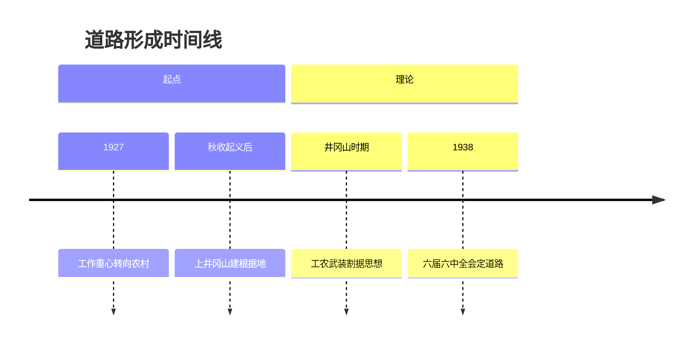

# 农村包围城市、武装夺取政权道路的开辟

## 它是什么

==核心结论：农村包围城市、武装夺取政权，就是“先占乡村，后取城市，最后夺取全国胜利”的革命道路==；这不是先搞城市起义，而是把武装斗争的主攻方向首先指向农村。

## 为什么需要

1927 年大革命失败后，党的工作重心开始转向农村。城市里敌人强、革命力量弱，照搬“先占城市后取乡村”走不通。秋收起义失败后，毛泽东率领队伍开赴井冈山，创建井冈山革命根据地，为中国革命保存了“星星之火”。

## 怎么做

毛泽东在井冈山斗争实践中写下《中国的红色政权为什么能够存在?》《井冈山的斗争》《星星之火，可以燎原》，提出“工农武装割据”思想，初步形成农村包围城市理论。红军长征到达陕北后，他分析近代中国时代特点和国情，论述中国革命的长期性和不平衡性，进一步丰富整体战略思想。1938 年 11 月，党的六届六中全会明确：

> [!IMPORTANT]
> 共产党任务基本不是长期合法斗争进入起义，也不是先占城市后取乡村，而是走相反道路。

## 和相近概念的区别

| 对比项 | 农村包围城市 | 先占城市后取乡村 |
|---|---|---|
| 主攻方向 | 先指向农村 | 先指向城市 |
| 斗争形式 | 长期武装斗争 | 长期合法斗争+起义 |
| 中国结论 | 走相反道路才胜利 | 不适合当时国情 |

## 常见的坑

> [!WARNING]
> 幼年时期的中国共产党还不能把马列原理和中国实践很好结合，判断题里若说“已经能够结合”就是错的。

>[!NOTE]
> 1927 年评论“国民革命需要大的农村变动，辛亥革命没有所以失败”的是毛泽东，不是陈独秀、李大钊或周恩来。

## 一个算对了的例子

题目：哪位革命家在井冈山建立革命根据地，保存“星星之火”且贡献理论与实践？答案是 **A. 毛泽东**。因为课件写明“秋收起义失败后，毛泽东率领队伍开赴井冈山”，并且上文三篇文章也是他写的；朱德、陈毅、刘伯承都不是该根据地的开创核心对应项。
