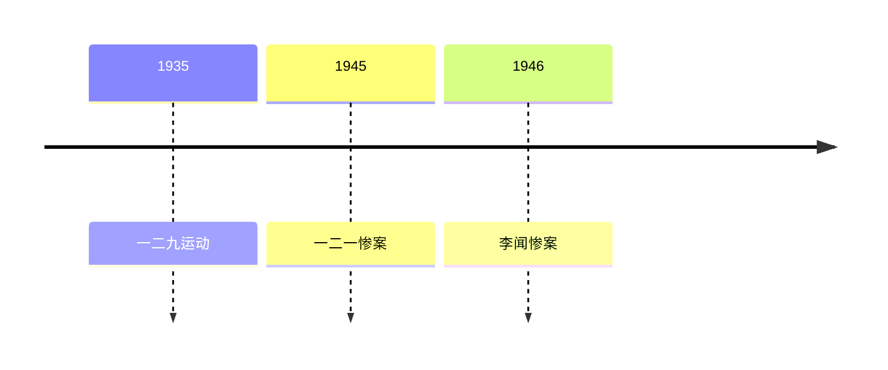

# 闻一多最后演讲与国统区青年的民主斗争

## 背景：抗战胜利后的国统区

抗日战争胜利后，国民党坚持独裁内战，国统区（国民党统治区）通货膨胀、特务横行，青年学生成为争取民主、反对内战的主力军。这一时期的青年运动与解放区战场相互配合，形成了==第二条战线==。

> [!IMPORTANT]
> 国统区青年民主斗争的三大标志性事件：**“一二·九”运动（1935）**、**“一二·一”惨案（1945）**、**“李闻惨案”（1946）**。三者时间递进、斗争升级，常考时间线与人物对应。

## 三次关键事件

| 事件 | 时间 | 地点 | 核心诉求 | 结果/意义 |
|---|---|---|---|---|
| “一二·九”运动 | 1935.12.9 | 北平 | 停止内战、一致抗日 | 掀起全国抗日救亡新高潮 |
| “一二·一”惨案 | 1945.12.1 | 昆明 | 反对内战、争取民主 | 4 名学生遇难，运动席卷全国 |
| “李闻惨案” | 1946.7 | 昆明 | 争取和平民主 | 李公朴、闻一多先后被暗杀 |

> [!TIP]
> 记口诀：**“一二九抗日，一二一反内战，李闻争民主”**——三个事件按时间排，诉求层层递进：抗日 → 反内战 → 争民主。

## “一二·一”惨案与闻一多《最后的演讲》

1945 年 11 月，昆明西南联大等校学生罢课反内战。12 月 1 日，国民党军警特务闯入校园投掷手榴弹，==于再、潘琰、李鲁连、张华昌==四名学生遇难，史称“一二·一”惨案。

1946 年 7 月，民主人士==李公朴==被特务暗杀；7 月 15 日，闻一多在李公朴殉难报告会上发表《最后的演讲》，痛斥反动派，当晚即遭暗杀。这篇演讲成为闻一多的“绝唱”，也标志着国统区民主斗争达到高潮。

> [!WARNING]
> 易混点：闻一多本人**不是**“一二·一”惨案遇难者，他是在 1946 年“李闻惨案”中牺牲的。做题时看清题干问的是哪一次事件。

## 常见考点与例题

**例题**：《最后的演讲》是闻一多先生在谁的殉难报告会上的演讲？（ ）

A. 李大钊　B. 李公朴　C. 于再　D. 宋教仁

**解析**：1946 年 7 月李公朴被暗杀后，闻一多在其殉难报告会上演讲。李大钊牺牲于 1927 年，于再是“一二·一”惨案遇难学生，宋教仁为民国初年人物。答案选 ==B==。

> [!NOTE]
> 延伸辨析：“一二·九”运动发生于**北平**（今北京），由中国共产党领导；“一二·一”运动发生于**昆明**，以西南联大学生为主体。地点与领导力量不同，不要张冠李戴。
