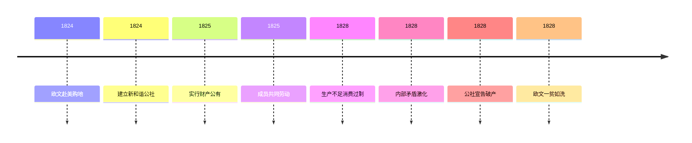

# 欧文的“新和谐公社”实验及空想社会主义者的不成熟预见

欧文是英国空想社会主义的代表人物之一。19 世纪初，面对工业革命带来的贫富分化，他没有停留在理论批判，而是倾尽家产，于 1824 年远渡美国，买下 1214 公顷土地，创办了名为**“新和谐公社”**的试验田。在这个公社里，实行财产公有、共同劳动、按需分配，试图建立一个没有剥削、没有压迫的理想社会。

> [!IMPORTANT]
> **核心结论**：欧文的新和谐公社是空想社会主义者试图通过**个人道德感化和和平试验**来改造社会的典型案例。它的失败证明：==空想社会主义不能科学揭示资本主义的内在矛盾，找不到实现社会变革的正确途径和依靠力量==。

## 为什么需要这场试验？

资本主义初期的残酷现实（贫富悬殊、周期性经济危机）让思想家们意识到必须寻找更高级的社会形态。但与以往只在著作中描绘理想不同，欧文选择**亲手实践**，试图用“事实”证明共产主义的优越性。这是社会主义从“空想到科学”过渡中的重要一环——它**需要被证明**，哪怕证明的是此路不通。

## 试验是怎么做的？

欧文设计了以公有制为基础的公社制度：全体成员共同劳动，消灭私有制，实行平均分配，成年人享有平等权利，儿童接受公共教育。

## 为什么会失败？常见误区

**常见的坑**在于把失败简单归因于“管理不善”或“成员觉悟低”。题目材料提到“生产少，消费多”，这确实是直接原因，但根本问题在于：

- **历史条件不成熟**：当时资本主义生产方式尚未充分发展，无产阶级尚未形成独立的政治力量。
- **路径错误**：幻想通过**和平改良**和**示范效应**（而非阶级斗争）让资产阶级自动退出历史舞台。
- **缺乏科学理论**：没有对资本主义基本矛盾（生产社会化与生产资料私人占有）的深刻剖析，因此找不到改造社会的物质力量。

> [!WARNING]
> **易错坑**：不要把欧文失败的原因归结为“人性本私”这种抽象人性论。空想社会主义者的局限在于**历史观**——他们不懂社会发展的客观规律，而非单纯不懂管理。

## 相近概念的区别

| 维度 | 空想社会主义（欧文） | 科学社会主义（马克思） |
| :--- | :--- | :--- |
| **理论基础** | 理性、正义、道德批判 | 唯物史观、剩余价值学说 |
| **实现途径** | 和平试验、阶级合作、富人发善心 | 阶级斗争、无产阶级革命 |
| **依靠力量** | 个别天才人物、有产者的同情 | 无产阶级 |
| **对资本主义** | 感性批判其“不道德” | 科学剖析其基本矛盾 |

## 一个“答对了”的例子

**题目（节选）**：“欧文倾尽家产创办新和谐公社……4 年后宣告破产，但他没有动摇信念。”  
**问**：这说明了什么？

**正确答题思路**：  
这说明空想社会主义者虽然具有献身精神和道德勇气（==坚定信念==），但其学说**脱离了资本主义发展的客观实际**。他们不懂得阶级斗争是阶级社会发展的直接动力，找不到埋葬资本主义、建设新社会的现实力量和正确途径。因此，尽管试验本身英勇悲壮，却注定失败，也凸显了创立科学社会主义理论的必要性。

> [!TIP]
> **记忆口诀**：**“好心办坏事，试验证此路不通”**——记住欧文代表的不是“错误的理想”，而是“不成熟的预见”，其失败为马克思恩格斯创立科学社会主义提供了宝贵的反面教材。
