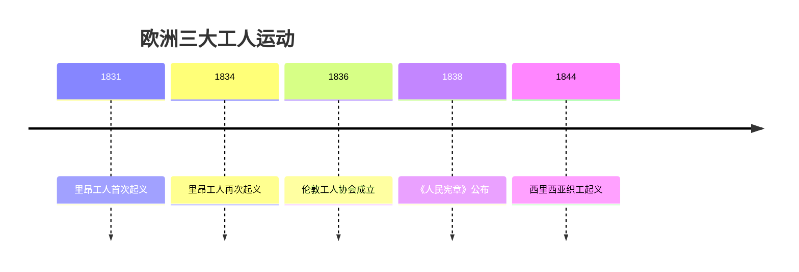
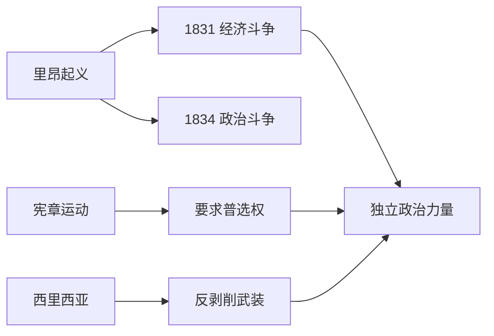

# 法国里昂起义、英国宪章运动、德国西里西亚起义

## 为什么会出现三大工人运动

资本主义大工业把工人聚在一起，但工资低、劳动条件差、政治上毫无地位。工人们最初只是砸机器、要求加薪，后来意识到：==光改善经济不行，必须夺取政治权利==。交通运输的发达又让各地区工人能互相联系，于是从 ==自发斗争走向有组织的政治斗争==。

三大工人运动正是这一转折的标志：法国里昂起义、英国宪章运动、德国西里西亚起义。

## 三大运动对比

| 运动 | 时间 | 国家 | 主要诉求 | 标志性意义 |
|---|---|---|---|---|
| 里昂工人起义 | 1831、1834 | 法国 | 增加工资 → 推翻富人政权 | ==最早的工人武装起义== |
| 英国宪章运动 | 1836—1848 | 英国 | ==普选权==、参与国家管理 | 独立政治力量登上舞台 |
| 西里西亚织工起义 | 1844 | 德国 | 反对地主和资本家剥削 | 独立政治力量登上舞台 |

> [!NOTE]
> 三次运动的共同结论：==无产阶级已经作为独立的政治力量登上了历史舞台==。这是它们最核心的统一考点。

## 逐个看清楚

**法国里昂纺织工人起义。** 1831 年 10 月，6000 多织工要求增加工资，喊出 ==“工作不能生活，毋宁战斗而死！”==，11 月 21 日转为起义，一度控制全城，12 月初被政府军镇压。1834 年 4 月再次起义，这次明确提出 ==推翻富人政权、争取民主共和国== 的政治口号，后被镇压。两次起义是 ==世界上最早的工人武装起义==。

**英国宪章运动。** 1836 年伦敦工人协会成立，制定《人民宪章》，中心内容是 ==要求普选权==，让工人参与国家管理。运动三次达到高潮、数百万人参加，但三次请愿书均被国会否决，集会、总罢工、领导人被捕判刑。它标志着英国无产阶级以独立政治力量登场。

**德国西里西亚纺织工人起义。** 1844 年 6 月 4—6 日，约 3000 起义工人捣毁厂主住宅、厂房机器、货栈，焚毁票据账册，并与政府军血战，最后失败。它表明德国无产阶级已作为独立政治力量登场。

> [!IMPORTANT]
> 三大运动的 ==共同历史意义==：无产阶级作为独立的政治力量登上了历史舞台。这也是选择题最常考的结论。

## 常见的坑

> [!WARNING]
> - **别把西里西亚记成“西西里”**——西里西亚在德国，西西里是意大利地名。真题选项里就出现过“西西里亚”，属于故意改字的干扰项。
> - **别把中国工运混进来**。山海关铁路工人大罢工属于中国工人运动，不属于欧洲三大工人运动，是典型干扰项。
> - **里昂起义最早**，是 1831、1834 两次；**宪章运动规模最大**，但目标是普选权而非武装夺权。

> [!TIP]
> 记忆口诀：==“里昂武装、宪章普选、西里西亚反剥削”==，三者都是 19 世纪上半叶、都在欧洲、都标志无产阶级独立登场。

## 一个做对了的例子

**题目**：在资产阶级与无产阶级矛盾日益尖锐的背景下，19 世纪上半叶欧洲爆发的著名工人运动有（ ）。
A. 英国宪章运动  B. 山海关铁路工人大罢工  C. 法国里昂工人两次武装起义  D. 德国西西里亚织工会起义

**思路**：先看时间与地域——要求是“19 世纪上半叶”“欧洲”。B 是中国工运，直接排除。D 写作“西西里亚”虽是笔误式的写法，但指代的就是德国西里西亚织工起义，属于正确项；这里不能因错字而误判为另一地名。A、C 显然正确。

**答案**：==ACD==。

> [!CAUTION]
> 遇到名字略有出入的选项，先判断它是否指向同一事件，再决定取舍；**地域和时间**是排除中国工运类干扰项的最快依据。
