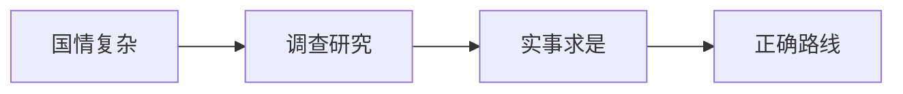

# 毛泽东思想的形成及其闪耀的真理光芒

## 它是什么

在“社会主义发展史”这条线上，毛泽东思想不是孤立出现的。它是马克思列宁主义在中国的运用和发展，是被实践证明了的关于中国革命和建设的正确理论原则和经验总结。先想一个问题：近代中国国情复杂，不能直接照搬俄国城市中心起义的经验，那革命道路该怎么选？答案正是毛泽东等人在实践中探索出来的。

## 为什么需要

旧中国内部外部矛盾交织，仅靠书本结论不够。需要把普遍原理与本国实际结合，才能找到保存力量、扩大力量的办法。井冈山根据地就是关键一步——在井冈山建立根据地、留下“星星之火”的，是==毛泽东==。这也为后来农村包围城市、武装夺取政权提供了实践基地。

## 怎么做：精髓与调查

毛泽东思想有多项内容，但==最大原则和精髓是实事求是==，它也是出发点和根本点。怎么做才算实事求是？先调查、再结论。毛泽东在《反对本本主义》里提出“没有调查就没有发言权”。

[!TIP]
记忆口诀：“精髓=实事求是；调查=《反对本本主义》”。

还要注意历史评价：是《关于建国以来党的若干历史问题的决议》确定了毛泽东同志的历史地位，并坚持和发展毛泽东思想。

## 相近概念的区别

| 说法 | 归属 | 易混提醒 |
|---|---|---|
| 实事求是 | 毛泽东思想精髓 | 不是武装斗争，也不是人民当家作主 |
| 没有调查就没有发言权 | 《反对本本主义》 | 不在《实践论》《矛盾论》《论持久战》里 |
| 井冈山根据地 | 毛泽东建立 | 不是陈毅、朱德、刘伯承 |

## 常见的坑

> [!WARNING]
> 把“理论联系实际”当最大原则会错；最大原则是实事求是。看到“最大原则/精髓/出发点”都优先想实事求是。

> [!CAUTION]
> “没有调查就没有发言权”极易被放到《实践论》或《矛盾论》里，实际出自《反对本本主义》。

## 一个算对了的例子

题干：下列哪位革命家在井冈山建立革命根据地，为中国革命保存了“星星之火”？A 毛泽东 B 陈毅 C 朱德 D 刘伯承。选 A。判断“实事求是是毛泽东思想的出发点和根本点”为正确，也是同一考点。

> [!NOTE]
> 做题时看到“井冈山/星星之火”→毛泽东；看到“精髓/最大原则/出发点”→实事求是。
