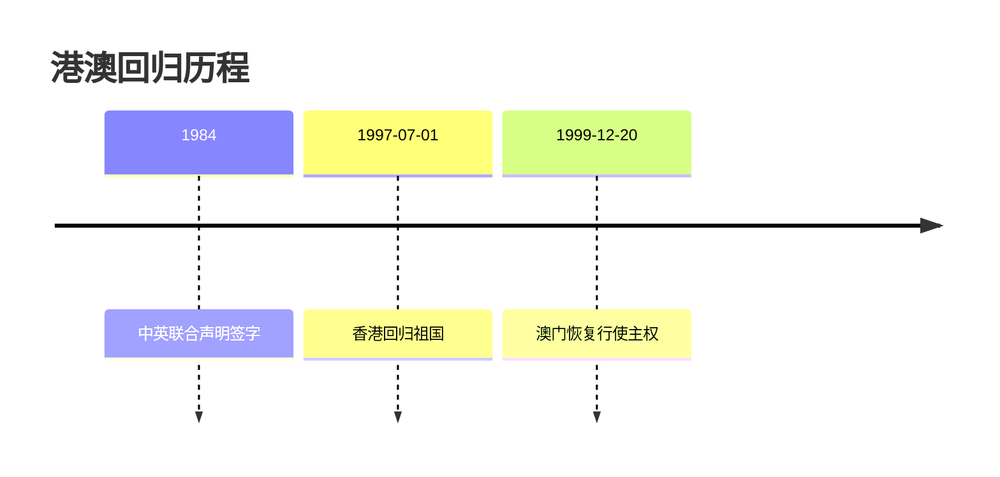

# “一国两制”构想与香港、澳门回归祖国（百年雪耻）

> [!IMPORTANT]
> “一国两制”即“一个国家，两种制度”，指在祖国统一的前提下，国家主体实行社会主义制度，港澳台保持原有资本主义制度长期不变。

## 为什么需要这一构想？

近代以来，香港、澳门先后被列强侵占，这是中华民族的百年屈辱。改革开放后，综合国力提升，解决历史遗留问题提上日程。但直接改变港澳社会制度可能引发动荡，如何既实现主权回归又保持繁荣稳定？邓小平同志创造性地提出了“一国两制”伟大构想。

## 港澳回归时间线

理清关键节点是应对选择题的核心：

- ==1984年==，邓小平出席中英两国政府《关于香港问题的联合声明》签字仪式，并会见英国首相撒切尔夫人。
- ==1997年7月1日==，中国政府对香港恢复行使主权，香港顺利回归祖国母亲的怀抱。
- ==1999年12月20日==，中国政府对澳门恢复行使主权。

> [!TIP]
> 记忆口诀：“八四声明定基调，九七港归雪前耻，九九澳回大团圆。”

## 与相近概念的区别

复习时容易将“一国两制”与其他政治制度混淆，请看下表辨析：

| 比较维度 | 一国两制 | 民族区域自治 |
| :--- | :--- | :--- |
| **适用地区** | 港澳台特别行政区 | 少数民族聚居区 |
| **社会制度** | 保留资本主义制度 | 实行社会主义制度 |
| **核心目的** | 实现祖国和平统一 | 保障少数民族当家作主 |
| **权力来源** | 中央授权的高度自治权 | 宪法赋予的自治权 |

> [!NOTE]
> “一国”是实行“两制”的前提和基础，“两制”从属和派生于“一国”。没有国家统一，就没有特别行政区的高度自治。

## 常见的坑

> [!WARNING]
> 年份张冠李戴！考题常把 1982（谈判起步）、1984（签署声明）、1997（香港回归）、1999（澳门回归）混在一起做干扰项。务必牢记：**声明看 84，港归看 97，澳归看 99**。

> [!CAUTION]
> 不要误认为“一国两制”意味着港澳拥有完全独立的主权。外交与国防事务由中央人民政府负责管理，高度自治不等于完全自治。

## 真题实战演练

我们拿课件中的典型题目来练手：

**题目**：（ ）年，邓小平同志出席中英两国政府《关于香港问题的联合声明》签字仪式，并会见英国首相撒切尔夫人。
A. 1978  B. 1982  C. 1984  D. 1991

**解题思路**：
1. 排除 A（1978 是十一届三中全会/改革开放起点）。
2. 排除 D（1991 与港澳回归主线无关）。
3. 区分 B 和 C：1982 年是撒切尔夫人首次访华开启谈判，而正式签署《联合声明》是在 ==1984年==。

**答案**：C。
