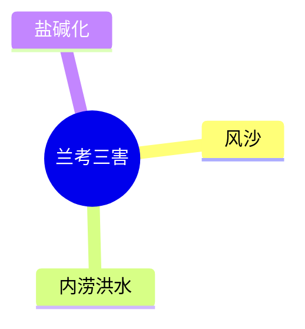
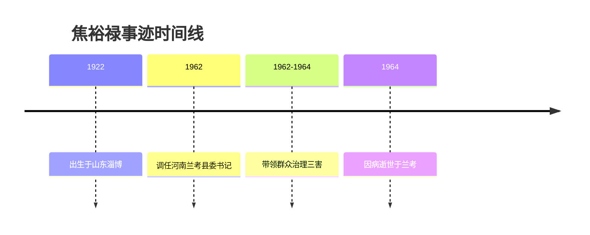

# 百姓谁不爱好官：焦裕禄治理兰考的事迹与焦裕禄精神

“百姓谁不爱好官”出自对焦裕禄同志的高度评价。一个县委书记，为什么能让老百姓记挂几十年？他到底做了什么？

## 焦裕禄是谁，做了什么

焦裕禄，==出生于山东淄博==，但他最后工作并献出生命的地方是==河南兰考==。1962 年冬，他被调到兰考担任县委书记。当时的兰考正遭受严重的自然灾害，他将治理“三害”作为自己毕生的事业。

什么是“三害”？

> [!IMPORTANT]
> “三害”专指==风沙、洪水（内涝）、盐碱化==，不包含泥石流等其他灾害。

面对恶劣环境，焦裕禄没有坐在办公室听汇报，而是带头查风口、探流沙、看水情。即使肝病恶化，他也用硬物顶着肝部坚持工作，直到 1964 年病逝。整理遗物时，在他的枕头下面发现了两本书：==《毛泽东选集》和《论共产党员的修养》==。

## 焦裕禄精神的内涵

在党史学习中，“焦裕禄精神”是一个高频考点。它集中概括为四句话：

- ==亲民爱民==：心中装着全体人民，唯独没有他自己。
- ==艰苦奋斗==：敢教日月换新天，革命者要在困难面前逞英雄。
- ==科学求实==：一切从实际出发，调查研究。
- ==迎难而上==：知难而进，无私奉献。

## 相近概念辨析与常见坑

考试中常将不同模范人物的事迹混在一起考查。注意区分他们各自的核心标签：

| 人物 | 核心事迹/标签 | 易混淆点 |
|---|---|---|
| 焦裕禄 | 治理兰考“三害”，枕下两本书 | 籍贯山东，工作在河南 |
| 吴佩芳 | 艰苦办学（沪剧《鸡毛飞上天》原型） | 不要和焦裕禄事迹张冠李戴 |
| 申纪兰 | 争取男女同工同酬，连任十三届人大代表 | 属于劳模代表，非治灾 |

> [!WARNING]
> 籍贯与工作地是选择题的高频陷阱！焦裕禄==生于山东淄博==，但==最后工作在河南兰考==。看到“出生”选山东，看到“最后工作”选河南。

> [!TIP]
> 记忆口诀：“淄博生，兰考干，风沙洪水加盐碱；枕下毛选与修养，亲民求实不怕难。”

## 真题实战

来看一道典型考题，检验你是否掌握了上述细节：

**题目**：整理焦裕禄的遗物时，在他的枕头下面发现了两本书，分别是（ ）。
A. 《毛泽东选集》
B. 《共产党宣言》
C. 《论共产党员的修养》
D. 《资本论》

**解析步骤**：
1. 回忆知识点：焦裕禄枕下的两本书体现了他的理论武装和党性修养。
2. 排除干扰项：《共产党宣言》和《资本论》虽是马克思主义经典，但不是该特定历史细节中的书目。
3. 锁定答案：==A 和 C==。

> [!NOTE]
> 2017 年五四青年节前夕，习近平总书记在==中国政法大学==考察时，也曾专门提及焦裕禄同志的事迹，勉励青年学生。这类“领导人讲话+模范人物”的组合也是《四史》课程的常考角度。
