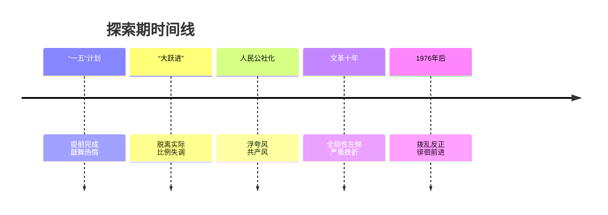

# 运用唯物史观正确看待社会主义革命和建设时期的成就与失误

运用唯物史观正确看待社会主义革命和建设时期的成就与失误，核心在于回答两个问题：这一时期究竟留下了什么？我们该用谁的视角去评判这段历史？

## 它是什么与为什么需要

唯物史观认为，==人民群众是历史的创造者==，而不是个别英雄或杰出人物。运用这一观点，就是要把1949年至1978年间的探索，放在“打基础”的客观历史条件下去评价，既不因成就掩盖失误，也不因失误否定成就。

我们需要这种视角，是因为如果脱离唯物史观，就容易陷入两个极端：要么把“大跃进”等错误归咎于个人而忽视当时缺乏经验的客观局限；要么因为后来的挫折就抹杀前20多年建立的工业底座。

## 怎么做：分清成就与失误

**看成就**：从“一五”时期到1976年的20多年，最大的建设成就是基本建立了==独立的、比较完整的工业体系和国民经济体系==，解决了工业化“从无到有”的问题。同时确立了“两步走”战略（第一步建体系，第二步全面实现四个现代化）。

**看失误**：“大跃进”和人民公社化运动源于急于求成，导致国民经济结构比例严重失调；“文化大革命”则是全局性的、长时间的“左”倾严重错误。

> [!IMPORTANT]
> 核心结论：成就为以后的发展奠定了牢固的物质技术基础，失误是缺乏经验、脱离实际的探索代价，二者统一于社会主义建设的艰辛探索中。

## 相近概念辨析

| 维度 | 唯物史观（正确） | 唯心史观（错误） |
| :--- | :--- | :--- |
| **历史创造者** | ==人民群众== | 时代英雄和杰出人物 |
| **对失误的归因** | 缺乏经验、脱离实际 | 纯粹个人意志决定 |
| **对成就的评价** | 奠定物质技术基础 | 归功于个别伟人 |

> [!NOTE]
> 杰出人物能影响、加速和推动历史进程，但绝不能说他们是“历史的创造者”。

## 常见的坑

> [!WARNING]
> 易错点：判断题常把“杰出人物”替换为“历史的创造者”来挖坑。看到“创造者”三个字，主语只能是人民群众。

> [!CAUTION]
> 高危误区：张冠李戴领导集体。完成新民主主义革命、进行社会主义改造、确立社会主义基本制度的是以毛泽东同志为核心的党的第一代中央领导集体，绝不是第二代。

## 算对了的例子

**题目**：唯物史观认为时代英雄和杰出人物能够影响、加速和推动历史进程，是历史的创造者。（ ）

**解析**：
前半句“影响、加速和推动”表述正确，杰出人物确实有此作用。但后半句定性为“历史的创造者”直接违背了唯物史观的根本原理。根据唯物史观，==人民群众才是历史的创造者==。

**答案**：×

> [!TIP]
> 记忆口诀：做题遇到“创造者”，只认“群众”不认“杰”；遇到“一五”到七六，记住“独立体系”是主流。
