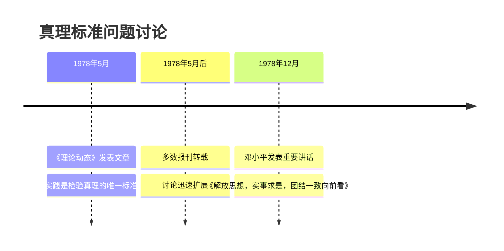

# 解放思想与关于真理标准问题的大讨论

## 什么是“解放思想与真理标准问题大讨论”

“解放思想与关于真理标准问题的大讨论”，是1978年围绕“实践是不是检验真理的唯一标准”展开的思想解放运动，也是中国改革开放的先导。它讨论的核心问题是：==如何重新认识马克思主义、毛泽东思想以及中国社会主义建设的实际道路==。

这场讨论不是一般性的学术争论，而是为了冲破个人崇拜和“两个凡是”的思想束缚，为纠正“左”的错误、推进改革开放创造条件。

## 为什么需要这场讨论

“文化大革命”结束后，党内仍存在思想僵化、迷信书本和权威的情况。当时的“两个凡是”方针，即“凡是毛主席作出的决定，我们都要坚持；凡是毛主席的指示，我们都要照办”，容易把个人指示直接等同于真理，忽视实践和现实情况。

因此，党和国家需要回答一个关键问题：

> 判断一种理论、政策和指示是否正确，究竟依据什么？

《实践是检验真理的唯一标准》一文明确指出，==检验真理的标准只能是社会实践，理论与实践的统一是马克思主义的一个最基本的原则==。任何理论都必须接受实践的检验，并随着实践的发展而不断丰富和发展。

## 讨论是怎样开展的

1978年5月10日，《理论动态》发表《实践是检验真理的唯一标准》一文，随后绝大多数报纸陆续转载，全国范围内形成关于真理标准问题的大讨论。

1978年12月13日，邓小平在中央工作会议闭幕式上发表《解放思想，实事求是，团结一致向前看》的讲话，进一步推动全党、全国重新确立实事求是的思想路线。

其基本含义是：==一切从实际出发，理论联系实际，在实践中检验和发展真理==。这也为随后恢复高考、扩大改革开放以及形成中国特色社会主义理论体系奠定了思想基础。

## “两个凡是”与解放思想的区别

| 比较项目 | “两个凡是” | 解放思想、实事求是 |
|---|---|---|
| 判断依据 | 依据个人指示 | 依据社会实践 |
| 理论态度 | 把既有结论绝对化 | 在实践中检验和发展理论 |
| 主要倾向 | 迷信权威、思想僵化 | 尊重事实、勇于探索 |
| 实践要求 | 以指示代替分析 | 理论联系实际 |

> [!IMPORTANT]
> “两个凡是”于1977年2月7日由《人民日报》《红旗》《解放军报》联合发表社论《学好文件抓好纲》提出。

> [!WARNING]
> 不要把“实践是检验真理的唯一标准”理解为“实践不需要理论指导”。马克思主义理论能够指导实践，但理论本身仍要接受实践检验，不能被当成永远无须检验的结论。

## 与恢复高考的联系

真理标准问题大讨论推动了思想解放，也为1977年恢复高考制度创造了条件。恢复高考最初曾形成“自愿报名、领导批准、公平考试、择优录取”的方针，最终确定的核心是：==自愿报名、公平考试、择优录取==。

这里要注意：

- **1977年**：恢复高考制度；
- **1978年**：真理标准问题大讨论兴起，邓小平发表重要讲话。

## 常见易错点

> [!CAUTION]
> 不要把文章的发表时间、讨论扩展时间和恢复高考时间混淆。

1. 《实践是检验真理的唯一标准》发表于**1978年**，不是1976年。
2. 1978年12月13日邓小平发表的是《解放思想，实事求是，团结一致向前看》。
3. 恢复高考是在**1977年**。
4. “两个凡是”提出于**1977年**，错误在于把个人指示绝对化。
5. “唯一标准”说的是**检验真理的标准**，不是否定理论的指导作用。

## 算对了的例子

题目问《实践是检验真理的唯一标准》一文发表的年份：

> 1976年？1978年？1980年？1984年？

抓住两个关键信息：

- 发表日期：**1978年5月10日**；
- 发表刊物：《理论动态》。

因此选择 **B．1978年**。

如果题目进一步问该文的主要观点，则应选择：检验真理的标准只能是社会实践；理论与实践相统一；坚持用实践检验真理；任何理论都要不断接受实际检验。
