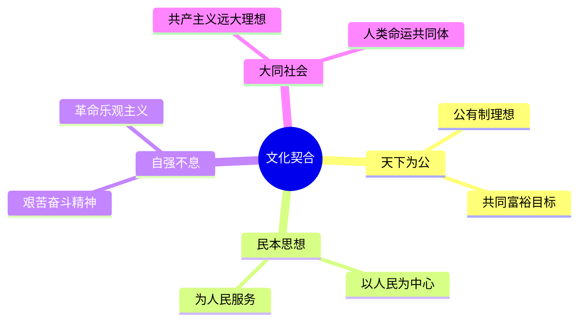

# 科学社会主义与中华优秀传统文化相融相通及文化自信

## 科学社会主义与中华文明相融相通

### 为什么科学社会主义能在中国扎根？

19 世纪中叶，马克思和恩格斯在《共产党宣言》中创立了科学社会主义，第一次把社会主义从空想变成了科学。但一个诞生于欧洲的理论，为何能在东方的中国开花结果？

关键在于，==科学社会主义与中华优秀传统文化在价值追求上高度契合==。这种契合不是偶然的巧合，而是两种思想体系对“好社会”的想象有着相似的底色。

### 文化基因里的“社会主义萌芽”

中国古代思想中，早已埋下了与社会主义相通的种子：

- **“大道之行，天下为公”**——《礼记》描绘的大同世界，与共产主义理想中消灭阶级、人人平等的社会图景一脉相通。
- **“民为贵，社稷次之”**——孟子的民本思想，与科学社会主义“以人民为中心”的发展理念深度契合。
- **“老吾老以及人之老，幼吾幼以及人之幼”**——这种推己及人的博爱精神，与社会主义倡导的集体主义价值观高度一致。
- **“国家兴亡，匹夫有责”**——千年古训凝聚的家国情怀，为社会主义培育集体意识和责任担当提供了文化土壤。

> [!IMPORTANT]
> 科学社会主义不是“外来移植”，而是与中华文明形成了**双向契合：中华文化为社会主义提供了文化根基，社会主义激活了传统文化的现代生命力。

### 从“文化契合”到“文化自信”

习近平在考察朱熹园时深刻指出：“如果没有中华五千年文明，哪里有什么中国特色？如果不是中国特色，哪有我们今天这么成功的中国特色社会主义道路？”

这段话揭示了一个核心逻辑链条：

==文化自信是更基础、更广泛、更深厚的自信==，是道路自信、理论自信、制度自信的精神支撑。当科学社会主义的理论逻辑与中华文明的历史逻辑内在贯通，这种自信就有了深厚的文化根基。

### 不可逾越的原则

> [!WARNING]
> 中国特色社会主义**不能与科学社会主义基本原则相分离**。

科学社会主义基本原则是方向性的规定：坚持公有制为主体、坚持按劳分配、坚持无产阶级政党的领导、坚持人的自由全面发展。丢了这些原则，就不是社会主义。

但同时，这些原则必须与中国的文化传统和现实国情相结合。脱离中华文明谈社会主义，是抽象的空谈；放弃基本原则谈中国特色，是方向的迷失。

### 易混淆辨析

| 对比项 | 空想社会主义 | 科学社会主义 |
|--------|-------------|-------------|
| 理论根基 | 理性与道德批判 | 唯物史观与剩余价值学说 |
| 对资本主义的认识 | 停留于道德谴责 | 揭示资本主义内在矛盾和发展规律 |
| 实现路径 | 劝说统治者、小范围试验 | 无产阶级革命与无产阶级专政 |
| 与传统文化关系 | 无自觉结合 | 与中华优秀传统文化主动融通 |

### 一个典型考题

> 中国特色社会主义的**文化自信**，通过设立纪念日、重温入党誓词和给党员过政治生日等仪式直观地呈现、传递和晕染。

**解析**：仪式是文化的载体。重温入党誓词、“政治生日”等政治仪式，承载的是对理想信念的文化认同。这种认同不靠强制灌输，而靠仪式感召和文化浸润——这正是==文化自信的独特作用==：它比理论说教更感性，比制度规定更柔软，却比两者都更持久、更深入人心。

### 小结

科学社会主义与中华优秀传统文化的相融相通，不是简单的“拼接”，而是马克思主义中国化的深层逻辑：让科学社会主义在中华文明土壤中生根发芽，让传统文化在社会主义实践中焕发新生。理解这一点，才能真正理解中国特色社会主义为什么“特”而有“根”，为什么“自信”而“从容”。
