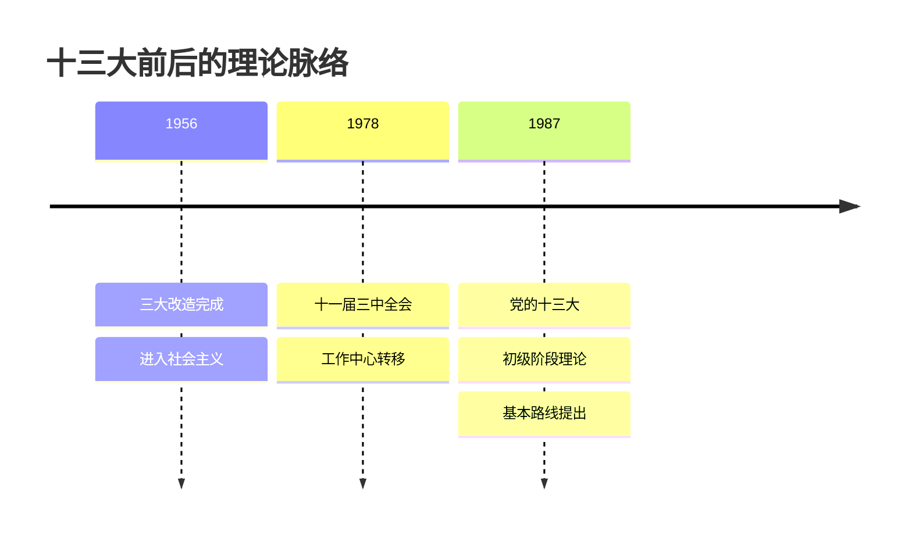

# 党的十三大与社会主义初级阶段理论及基本路线的提出

## 为什么需要“社会主义初级阶段”这个判断

想一想：既然我国已经是社会主义社会，为什么还要强调“初级阶段”？因为 1956 年三大改造完成后，我们一度忽视了生产力落后的现实，急于求成搞“一大二公”，结果吃了苦头。==社会主义初级阶段理论==正是对党情、国情再认识后的结论：它既肯定我国的社会性质（已经是社会主义），又承认发展程度（还处在初级阶段），从而把路线、方针、政策都建立在这一最大实际上。

## 党的十三大与理论、路线的提出

1987 年党的十三大系统阐述了==社会主义初级阶段理论==，并据此提出党在社会主义初级阶段的基本路线。

> [!IMPORTANT]
> 基本路线完整表述：领导和团结全国各族人民，以经济建设为中心，坚持四项基本原则，坚持改革开放，自力更生，艰苦创业，为把我国建设成为富强、民主、文明的社会主义现代化国家而奋斗。其核心被概括为==“一个中心、两个基本点”==。

## 科学内涵与核心内容

| 维度 | 第一层含义 | 第二层含义 |
|---|---|---|
| 社会性质 | 我国社会==已经是社会主义社会== | 必须坚持社会主义，不能倒退 |
| 发展程度 | 我国的社会主义还==处在初级阶段== | 不能超越阶段、急于求成 |

由此推出==社会主义初级阶段的最根本任务是发展生产力==——性质要求坚持社会主义，程度落后则要求先解决生产力不足的问题。

> [!TIP]
> 记“一个中心、两个基本点”：中心是==经济建设==，两个基本点是==四项基本原则==（立国之本）与==改革开放==（强国之路）。判断题常把“政治建设”“社会建设”偷换成中心，注意排除。

## 常见易错点

> [!WARNING]
> - 初级阶段≠“正在向社会主义过渡”：1956 年后我国已是社会主义社会，不能再选“正在进行社会主义”。
> - 初级阶段≠生产力已超越：任何“已经超越初级阶段”的说法都错。
> - 十三大主题≠十四大：==确立社会主义市场经济体制改革目标是十四大（1992）==，别张冠李戴。

## 一个算对了的例子

选择题：社会主义初级阶段的科学内涵是（多选）
- A. 我国正在进行社会主义
- B. 我国社会已经是社会主义社会
- C. 我国的社会主义社会还处在初级阶段
- D. 我国的生产力水平已经超越了社会主义初级阶段

按“性质—程度”两层分析：B 对应第一层，C 对应第二层；A 混淆了“过渡时期”，D 与“初级阶段”矛盾。故答案为==BC==。同理，单选“一个中心”锁定经济建设，单选“最根本任务”锁定发展生产力，均由此推出。
