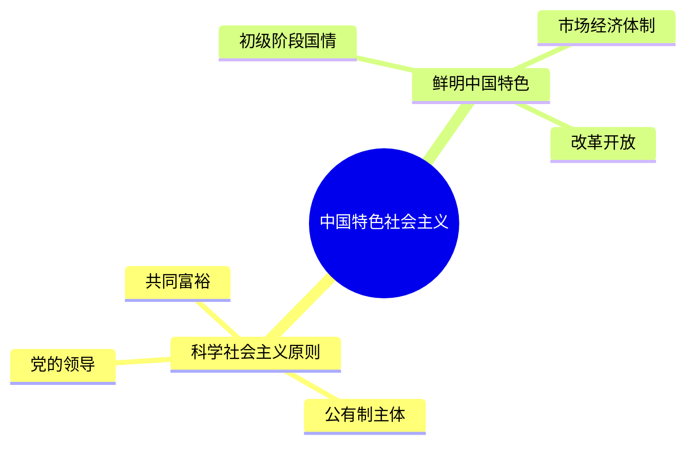

# 中国特色社会主义使社会主义在中国焕发出强大生机活力

## 核心内涵：原则与特色的辩证统一

中国特色社会主义并非独立于科学社会主义之外的新主义，而是==科学社会主义基本原则与中国具体实际相结合的产物==。它既坚持了马克思主义关于生产力决定生产关系、共同富裕等根本原则，又根据中国国情和时代特征赋予了鲜明的“中国特色”。

> [!IMPORTANT]
> 核心结论：中国特色社会主义是科学社会主义理论逻辑和中国社会发展历史逻辑的辩证统一。

我们可以用以下逻辑图理解其构成：

## 为什么需要：生命力的源泉

20世纪末，东欧剧变、苏联解体使世界社会主义陷入低潮。但这仅是**苏联模式**的失败，而非社会主义本身的失败。中国特色社会主义之所以能焕发生机，是因为它解决了两个关键问题：
1.  **解放生产力**：通过改革开放，克服了传统计划经济对生产力的束缚。
2.  **维护公平正义**：在发展中逐步消除两极分化，体现社会主义的道义力量。

> [!TIP]
> 记忆要点：社会主义的生命力归根结底是==真理的力量==和==道义的力量==。

## 常见误区与辨析

在学习过程中，最容易混淆的是“特色”与“原则”的关系。请看下表对比：

| 维度 | 科学社会主义基本原则 | 中国特色社会主义 |
| :--- | :--- | :--- |
| **性质** | 根本遵循，不可动摇 | 实践形式，与时俱进 |
| **关系** | 根基 | 枝叶与果实 |
| **错误观点** | 认为可以脱离原则搞“特色” | 认为必须照搬书本教条 |

> [!WARNING]
> 易错坑：判断题中若出现“中国特色社会主义可以与科学社会主义基本原则相分离”，必选**错误**。二者是源与流、根与叶的关系，不可分割。

## 典型例题解析

结合课件中的判断题，我们来验证这一知识点：

**题目**：中国特色社会主义既坚持了科学社会主义的基本原则，又根据时代条件赋予了鲜明的中国特色。
- A. √
- B. ×

**解析**：
此题考察对两者关系的理解。中国特色社会主义没有丢掉老祖宗（科学社会主义原则），也没有固守老本子（苏联模式），而是实现了创新。因此答案为 **A (√)**。

再看一道相关选择题，虽然考查的是“老西藏精神”，但其背后体现的正是社会主义制度下人民的精神风貌和生命力：
**题目**：“老西藏精神”包括以下（ ）。
- A. 特别能吃苦
- B. 特别能忍耐
- C. 特别能战斗
- D. 特别能团结

**答案**：ABCD。这体现了社会主义建设中人的全面发展和社会凝聚力，是社会主义生机活力在精神层面的投射。

> [!NOTE]
> 延伸思考：为什么说“只有社会主义才能救中国”？这是从五四运动至今的历史结论。中国特色社会主义则是让中国“富起来”、“强起来”的关键一招，两者一脉相承。
