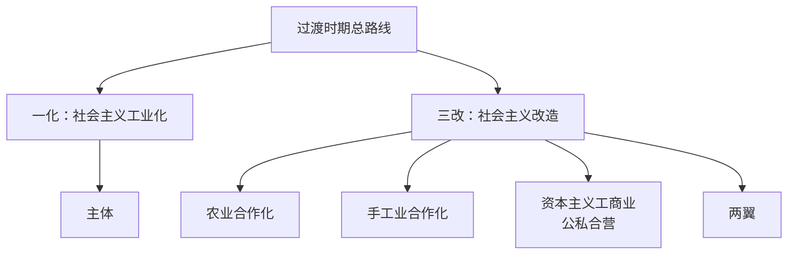

# 三大改造完成与社会主义基本制度在中国的确立

## 三大改造是什么

1953 年至 1956 年，中国共产党领导了对 ==农业、手工业和资本主义工商业== 的社会主义改造，史称"三大改造"。它的核心目标是把生产资料私有制转变为社会主义公有制，使中国从新民主主义社会过渡到社会主义社会。

> [!IMPORTANT]
> 三大改造的具体对象是：==农业、手工业和资本主义工商业==。注意：==不包括重工业==，重工业属于"一化三改"中"一化"（社会主义工业化）的内容。

## 为什么需要三大改造

新中国成立初期，国民经济中存在五种经济成分，其中国营经济掌握命脉，但个体经济和私人资本主义经济仍占很大比重。随着大规模工业化建设的展开，分散落后的小农经济和私人资本主义经济与社会主义工业化之间的矛盾日益突出。为了建立社会主义经济基础、解放和发展生产力，必须对生产资料私有制进行社会主义改造。

## 怎么改：一体两翼、一化三改

1953 年 6 月，中共中央正式提出党在过渡时期的总路线，其实质就是"一体两翼"和"一化三改"。

- **主体（一化）**：实现国家的社会主义工业化。
- **两翼（三改）**：逐步实现国家对农业、手工业和资本主义工商业的社会主义改造。
- **关系**：主体和两翼是不可分割的整体，"一化"为"三改"提供物质基础，"三改"为"一化"开辟道路。

> [!TIP]
> 记忆口诀：=="一体两翼、一化三改"=="一化"是工业化（主体），"三改"是改三个行业（两翼）。选择题常考"三改"具体指哪三个行业，务必记牢。

## 三大改造的完成与社会主义制度的确立

1956 年底，三大改造基本完成，实现了把生产资料私有制转变为社会主义公有制。这一伟大变革标志着：

| 维度 | 改造前 | 改造后 |
|------|--------|--------|
| 经济制度 | 私有制为主 | 公有制为主体 |
| 社会性质 | 新民主主义社会 | 社会主义社会 |
| 发展阶段 | 过渡时期 | 社会主义初级阶段 |

> [!IMPORTANT]
> 1956 年三大改造基本完成，==标志着社会主义基本制度在我国初步建立==，中国从此进入社会主义初级阶段。这是 20 世纪中国的一次历史性巨变。

## 与相近概念的区别

| 概念 | 时间 | 核心内容 | 标志意义 |
|------|------|----------|----------|
| 新中国成立 | 1949年 | 民族独立、人民解放 | 中国人民站起来 |
| 三大改造完成 | 1956年 | 私有制转公有制 | 社会主义制度确立 |
| 中共八大 | 1956年9月 | 分析主要矛盾、确定主要任务 | 探索建设道路的开端 |

> [!WARNING]
> 易混淆：==三大改造完成≠社会主义建成==。三大改造完成后，我国进入的是==社会主义初级阶段==，而非发达的社会主义。中共八大正是在三大改造完成后召开的，正确分析了这一时期的主要矛盾。

## 常见考点与例题

**例题**："三大改造"具体指（ ）。
- A. 农业　B. 手工业　C. 重工业　D. 资本主义工商业

**答案**：ABD

**解析**："三改"指对农业、手工业和资本主义工商业的社会主义改造。重工业属于"一化"（社会主义工业化）的内容，不属于"三改"范畴。这类题目常把"工业化"混入"三改"中设置干扰项，审题时要分清"一化"与"三改"的边界。

> [!CAUTION]
> 高危误区：不要误认为三大改造是"消灭一切私有制"。改造完成后，公有制成为主体，但在一定范围内仍保留了个体经济和私营经济的补充作用。关键是==公有制的主体地位==的确立。
