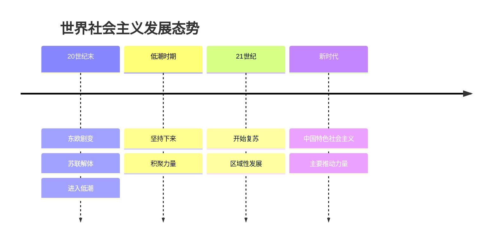

# 当代世界社会主义发展新态势与社会主义事业的永恒生命力

## 21 世纪世界社会主义的形势

东欧剧变、苏联解体使世界社会主义进入低潮时期。但苏联、东欧社会主义的失败，只是==苏联模式的失败==，而不是社会主义本身的失败。

## 社会主义为什么具有永恒生命力

社会主义具有强大生命力，这种生命力归根结底是==真理的力量，也是道义的力量==。

| 维度 | 社会主义制度的优势 | 为发展提供什么 |
|------|------------------|---------------|
| 生产力 | 从根本上克服生产资料的资本主义私有制对生产力发展的束缚 | 为生产力的发展提供广阔的前景 |
| 人的发展 | 从根本上消除资本主义导致的两极分化和不公平不公正现象 | 为人的发展提供可靠的保障 |

这就是我们对社会主义保持必胜信念的坚实根据。

> [!IMPORTANT]
> 世界社会主义运动已经开始复苏，并出现区域性强劲发展，特别是==中国特色社会主义成为世界社会主义运动的主要推动力量==。

## 时代背景与相近概念辨析

理解当代世界社会主义的发展，还要把握时代主题和时代潮流。

| 概念 | 核心内容 | 常见考法 |
|------|---------|---------|
| 时代主题 | 和平与发展 | 发展问题是当代世界经济最核心的问题和集中体现 |
| 时代潮流 | 世界要和平，人民要合作，国家要发展，社会要进步 | 判断题常考完整表述 |
| 时代特征 | 与特定时代相适应的国际政治经济关系的基本状态，以及由世界的基本矛盾所决定和反映的基本特征 | 判断题常考定义 |

> [!WARNING]
> 不要把“苏联模式失败”写成“社会主义失败”；也不要把“最核心的问题和集中体现”误选为和平、贸易或金融，正确对应是==发展问题==。

## 例题

**题目：**（　）问题是当代世界经济最核心的问题和集中体现。  
A. 和平　B. 贸易　C. 金融　D. 发展

**答案：D。**

**解析：**时代主题是和平与发展，其中发展问题是当代世界经济最核心的问题和集中体现。由此可进一步理解：世界社会主义在低潮中坚持下来、不断积聚力量并实现新的发展，正体现了社会主义事业的永恒生命力。
