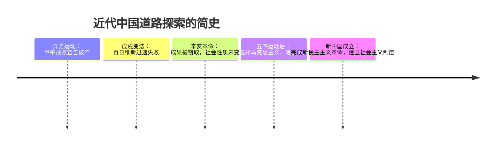

# 历史证明社会主义没有辜负中国

在《社会主义发展史》的学习中，“社会主义没有辜负中国”不仅是一个庄严宣告，更是一条被百年历史反复验证的客观规律。它不是空洞的口号，而是对近代以来中国命运转折的精确总结。

### 从救亡图存到根本转折

要理解这个知识点，我们可以先思考一个问题：**为什么近代以来各种救国方案都未能彻底改变中国的命运，而社会主义却成功了？**

鸦片战争后，中国尝试过君主立宪、议会共和、总统制等多种道路，但都因脱离国情或阶级局限而失败。直到五四运动后，中国先进分子选择了马克思列宁主义，成立了中国共产党，局面才发生根本改变。

这段历史直接导向一个核心结论：
> [!IMPORTANT]
> 中国选择社会主义道路，是历史发展的必然结果，不是偶然的政治决定。==只有社会主义才能救中国==，这是基于切身体验得出的不可动摇的历史结论。

### 从“破坏旧世界”到“建设新世界”

中国共产党和中国人民不仅善于打破一个旧中国，更善于建设一个新中国。社会主义制度建立后，我们在“一穷二白”的基础上建立了独立完整的工业体系和国民经济体系。

这里有一个常见的认知误区需要辨析：
> [!CAUTION]
> **分清前30年与后40年的关系。** 不能因为计划经济时期存在失误，就否定社会主义根本制度；也不能因为改革开放后的成功，就认为社会主义初级阶段不需要夯实基础。两个时期本质上都是社会主义的实践探索。

改革开放后，我们开创了**中国特色社会主义**，它不是“放弃”社会主义，而是根据中国国情对社会主义的坚持和发展：

| 对比维度 | 传统社会主义模式（如苏联） | 中国特色社会主义 |
| :--- | :--- | :--- |
| **经济体制** | 高度集中的指令性计划经济 | 社会主义市场经济（市场与政府更优结合） |
| **发展阶段** | 脱离实际，急于向共产主义过渡 | 科学确认“社会主义初级阶段”，长期不懈奋斗 |
| **外部关系** | 阵营对抗、自我封闭 | 全方位对外开放，融入全球发展 |
| **最终结果** | 体制僵化，
