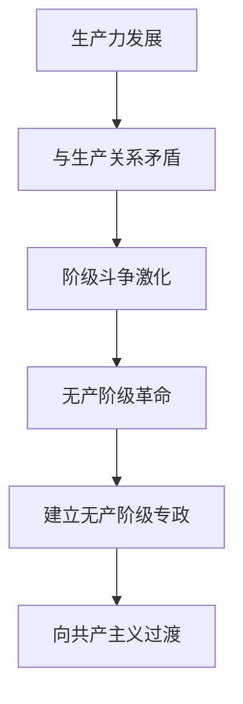

# 《共产党宣言》阐述的科学社会主义基本原则

## 科学社会主义基本原则的核心内容

《共产党宣言》第一次系统阐述了科学社会主义的基本原则。理解这些原则，关键是回答一个问题：**社会主义为什么必然代替资本主义？** 答案不在道德义愤里，而在历史规律中。

科学社会主义的立论根基是**历史唯物主义**。它承认：

> [!IMPORTANT]
> 生产力与生产关系的矛盾运动是社会发展的根本动力，生产关系一定要适应生产力的发展水平。

由此推导，《共产党宣言》提出了几项不可动摇的基本原则：

- **消灭私有制**：生产资料归社会所有，铲除剥削的经济基础。
- **无产阶级专政**：工人阶级上升为统治阶级，建立自己的政治统治。
- **共产党的领导**：共产党是无产阶级中最先进、最坚决的部分。
- **人的自由全面发展**：最终目标是建立“每个人的自由发展是一切人的自由发展的条件”的联合体。

这四项原则中，==消灭私有制是经济基础，无产阶级专政是政治保障，共产党领导是组织核心，人的解放是最终归宿==。

---

## 相近概念辨析：无产阶级专政 ≠ 农民阶级专政

课件中的考题反复考这个点：

> [!WARNING]
> 科学社会主义主张无产阶级（工人阶级）领导革命并建立**无产阶级专政**，而不是农民阶级专政。原始表述出自《共产党宣言》和《中国共产党第一个纲领》，选项 D“承认农民阶级专政”是错误的。

为什么是无产阶级而不是农民阶级？因为只有无产阶级与最先进的生产方式（大工业）相联系，最有组织性和纪律性。农民阶级在革命中可以可靠地联合，但受小生产局限，不能独立充当领导阶级。

再来一道判断题所暴露的误区：

> [!CAUTION]
> “中国特色社会主义可以与科学社会主义基本原则相分离”——判断为错误。中国特色社会主义是科学社会主义基本原则在中国的具体实现形式，==不是另起炉灶==。

---

## 一条主线串起相关考点

把这几道题放在一起看，逻辑就清楚了：

| 题目 | 考点 | 正确结论 |
|------|------|----------|
| 历史创造者是谁 | 历史唯物主义 | 人民群众，不是英雄帝王 |
| 生产力与生产关系 | 历史唯物主义 | 生产关系必须适应生产力 |
| 第一个纲领的内容 | 无产阶级专政 | 是工人阶级专政，不是农民阶级专政 |
| 中国特色社会主义与科学社会主义 | 坚持基本原则 | 坚持基本原则 + 赋予中国特色 |

如果你理解了“生产方式决定社会形态”这条主链，就会发现选择题、判断题只是它的不同侧面。

> [!TIP]
> 答题时看到“农民阶级专政”“英雄创造历史”“与科学社会主义相分离”这类表述，直接判错——它们都与《共产党宣言》的核心逻辑相悖。
