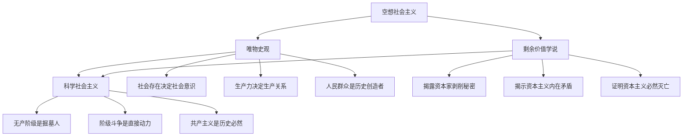

# 从空想社会主义到科学社会主义的飞跃

## 从空想到科学的飞跃

在社会主义思想史上，有一个根本性的转变：社会主义不再只是善良的愿望，而成为一门严谨的科学。这一飞跃是如何完成的？

### 空想社会主义的局限

早期的社会主义思想家——圣西门、傅立叶、欧文——敏锐地揭示了资本主义的弊病，描绘了未来理想社会的图景。但他们有一个共同的困境：

- 他们把社会主义看作 **“天才头脑的偶然发现”**，而不是社会发展的必然结果
- 他们寄希望于 **统治者和富人的良心发现**，幻想通过和平宣传实现理想
- 他们看不到 **无产阶级的历史使命**，把无产阶级只看作值得同情的受苦群体

> [!WARNING]
> 空想社会主义的根本缺陷：==不懂社会发展规律，找不到实现理想的阶级力量==。这就像拥有精确的地图，却没有交通工具和驾驶员。

### 历史怎么走向科学的？

恩格斯曾精辟地概括了两大理论基石：

#### 唯物史观的发现

马克思和恩格斯不再从抽象的“理性”“正义”出发，而是分析现实的经济关系。他们指出：

- ==一切社会变迁的终极原因，不在人们的头脑中，而在生产方式和经济基础的变革中==
- 阶级的产生、发展和消亡，归根结底由生产力的发展水平决定
- 人民群众是社会物质财富和精神财富的创造者，是==推动历史前进的决定力量==

> [!IMPORTANT]
> 判断题“唯物史观认为时代英雄和杰出人物能够影响、加速和推动历史进程，是历史的创造者”是错误的——英雄人物可以加速或延缓历史进程，但==人民群众才是历史的真正创造者==。

#### 剩余价值学说的揭露

古典政治经济学承认劳动是价值的源泉，但无法解释资本家如何在不违反价值规律的情况下获得利润。马克思找到了答案：

资本家按劳动力价值（工资）购买工人一天的使用权，却让工人劳动更长的时间。

| 概念 | 劳动时间 | 创造的价值 | 归谁 |
|------|----------|------------|------|
| **必要劳动** | 4小时 | 劳动力价值（工资） | 工人 |
| **剩余劳动** | 4小时 | ==剩余价值== | 资本家无偿占有 |

这解释了：利润不是来自不等价交换的“欺骗”，而是来自生产过程中对剩余价值的无偿占有。资本主义生产方式本身就包含着==资产阶级与无产阶级不可调和的阶级对抗==。

### 为什么不可以？

在回答“社会主义从空想到科学”时，三个常见误区值得注意：

> [!CAUTION]
> **误区一**：以为空想社会主义完全不科学。实际上，它提供了宝贵的思想材料，只是分析方法和实践路径是空想的。

> [!CAUTION]  
> **误区二**：混淆“无产阶级专政思想”的出处。马克思最明确提出无产阶级专政理论，是在 **《致魏德迈的信》** 中，而非《共产党宣言》。

> [!TIP]
> **辨析**：《共产党宣言》奠定了无产阶级革命和无产阶级专政的基本原则，但“无产阶级专政”这一精确概念的首次明确表述，见于马克思1852年致魏德迈的信。

> [!CAUTION]
> **误区三**：以为马克思和恩格斯最先实践了革命理论。==列宁==领导俄国十月革命，使科学社会主义第一次从理论变为现实，回答了“最先将马克思主义革命理论付诸实践的是谁”。

### 算对了的例子

回顾考题：列宁将赫拉克利特称为“辩证法的奠基人”，因为这位古希腊哲学家第一个明确提出 ==“万物皆流，万物皆变”== 的思想。这体现了辩证法与唯物史观一脉相承的思维特征——不是孤立静止地看社会，而是从发展和矛盾的角度把握历史。

正是这种科学方法论，让马克思不再幻想“发明”理想社会，而是从资本主义的现实运动中“发现”新社会的萌芽，从而完成了社会主义思想史最深刻的变革。
