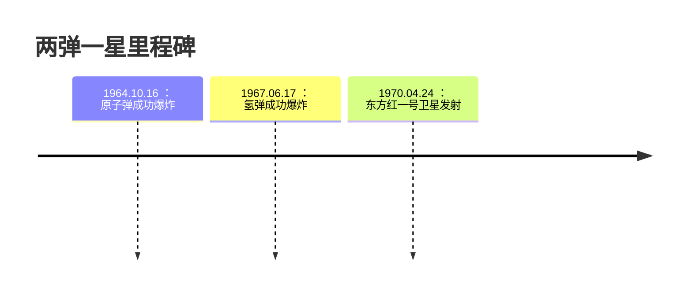

# 社会主义建设时期的重大科技突破（两弹一星等）

# 社会主义建设时期的重大科技突破（两弹一星等）

## 什么是“两弹一星”

“两弹一星”是新中国成立初期科技成就的标志性概括，具体指：

- **核弹**（原子弹、氢弹）
- **导弹**（通常指弹道导弹）
- **人造卫星**

> [!IMPORTANT]
> ==“两弹”最初指原子弹和导弹，后来演变为核弹（原子弹+氢弹）和导弹的合称。== 考试中“两弹一星”的“两弹”通常选**核弹 + 导弹**，要留意这个约定。

多选常考选项辨析：火箭弹 ≠ 导弹，不归入“两弹一星”范畴；原子弹和氢弹都属于“核弹”这一类。

## 为什么需要“两弹一星”

新中国成立后，面对严峻的国际封锁和核威胁，没有过硬的国防科技难以保障国家安全。1955年钱学森归国，1956年党中央号召“向科学进军”。发展“两弹一星”本质上是要突破国外的**技术封锁**，把尖端武器的主动权握在自己手里，同时在航天、电子等领域带动整体科技进步。

## 关键时间节点与“四个星”

```timeline
title 两弹一星关键里程碑
1964 : 第一颗原子弹爆炸
1967 : 第一颗氢弹爆炸
1970 : 第一颗人造卫星东方红一号
```



> [!TIP]
> 记忆口诀：**“64原子弹，67氢弹，70卫星上天。”** 三年三台阶，最短的“原子弹 → 氢弹”跨度仅 ==两年零八个月==（1964.10 → 1967.06），这在世界大国中是速度最快的。

## 原子弹与氢弹的时间差：两年零八个月

题目常把时间差的几种可能列在选项里：

| 起点 → 终点 | 跨度 |
|---|---|
| 原子弹试验成功（1964.10.16） → 氢弹试验成功（1967.06.17） | ==两年零八个月== |
| 常见干扰项 | 四年 / 四年零七个月 / 七年零四个月 |

2024年多次真题都围绕这个“两年零八个月”设问，务必牢记精确到月。

## 常见易混点与误区

> [!WARNING]
> - 我国第一颗原子弹爆炸是 **1964年**，不是1970年；1970年是第一颗人造卫星发射。
> - “两弹一星”不包括“火箭弹”，**火箭弹属于常规弹药**，与导弹在制导方式上本质不同。
> - “东方红一号”属于**人造卫星**范畴，不是导弹或核弹。

> [!CAUTION]
> 跨时期混淆：1964年原子弹试验成功属于 **“社会主义建设时期”**，千万不能归入1978年之后的改革开放阶段。题目如果要求选出“新中国成立到改革开放前”的科技成就，“两弹一星”全系列都算。

## 出一道题，一起推演

**题干：** 我国第一颗原子弹爆炸成功是在哪一天？（  ）  
A. 1970年4月24日  
B. 1967年6月17日  
C. 1964年10月16日  
D. 2003年10月15日  

**推演：**  
1. 先排除纯干扰项：D（2003年，载人航天年代，远晚于原子弹）；  
2. 再排除B（1967年是氢弹）；  
3. 剩下A和C：1970年4月24日是东方红一号卫星，所以 !=原子弹爆炸；  
4. 最终选C——1964年10月16日，我国第一颗原子弹爆炸成功。  

**答案：** C

## 理解“两弹一星”精神的视角

“两弹一星”除了科技突破本身，更代表一种自力更生、集体攻关的组织方式。钱学森、邓稼先等科学家隐姓埋名，在艰苦条件下实现了“从0到1”的跨越。这种模式后来也影响了“北斗”“载人航天”等工程的管理思路。
