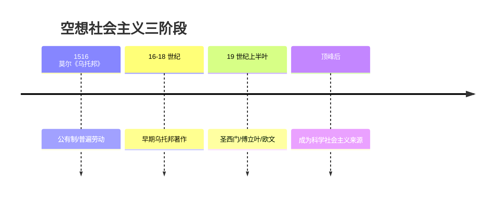

# 托马斯·莫尔《乌托邦》与空想社会主义思潮回眸

## 它是什么

`Utopia` 是托马斯·莫尔在 1516 年写的一本游记。你可以把它想成一次“思想实验”：如果社会不再围绕私有财产运转，而是实行**公有制**、人人参加**普遍劳动**、由社会来**组织生产**，生活会变成什么样？这本书第一次完整画出这种图景，因此在“社会主义发展史”里被视为**欧洲第一本空想社会主义著作**。

## 为什么需要它

先想一个问题：16 世纪英国正在发生什么？圈地运动把农民从土地上赶走，资本原始积累带着血腥味登场。莫尔在书里做了一件很关键的事——他不是单纯幻想“远方乐土”，而是**首次批判了资本原始积累的罪恶**。也就是说，空想社会主义从诞生起就有两副面孔：

- 批判现实里的资本主义萌芽；
- 描绘一个以平等、公有制为基础的新社会。

所以它不是“拍脑袋想出来的桃花源”，而是对现实矛盾的回应。后来圣西门、傅立叶、欧文把它推到顶峰，再被马克思、恩格斯改造，成为**科学社会主义的直接思想来源**。

## 它怎么做：思潮脉络一张图

## 和相近概念的区别

很多同学把“空想社会主义”和“科学社会主义”混为一谈。看这张表就够了：

| 对比项 | 空想社会主义 | 科学社会主义 |
|---|---|---|
| 产生时间 | 16 世纪初—19 世纪上半叶 | 19 世纪中期以后 |
| 代表人物 | 莫尔、圣西门、傅立叶、欧文 | 马克思、恩格斯 |
| 对资本主义 | 辛辣批判 | 阐明本质规律 |
| 实现路径 | 没找到现实道路 | 依靠无产阶级运动 |
| 是否科学体系 | ==不是科学思想体系== | ==是科学思想体系== |

## 常见的坑

> [!WARNING]
> 别把“社会主义”这个词当成马克思发明的。它源于拉丁语 `sociare`（联合/共享）；名词 `socialisme` 是法国空想社会主义者**圣西门**创造的。恩格斯后来才进一步说明：现代社会主义是**思想体系、现实运动、社会制度**三者的统一。

> [!CAUTION]
> 考试里最容易丢分的一句：空想社会主义只是“反映了早期无产阶级意识和利益的先声”，又说它是“科学社会主义的直接来源”；但它**没有阐明资本主义本质规律，也找不到现实道路**，所以不能说它科学。

## 算对了的例子

题目：简述《乌托邦》在社会主义思想史上的地位。

答：它是英国人莫尔 1516 年出版的游记，是欧洲第一本空想社会主义著作；首次批判资本原始积累罪恶，提出以组织生产、普遍劳动为基础的==公有制与平等原则==，奠定空想社会主义根基，为科学社会主义提供思想材料。

> [!TIP]
> 记忆口诀：**莫尔乌托邦，公有劳动忙；批原始积累，源头不能忘。**
