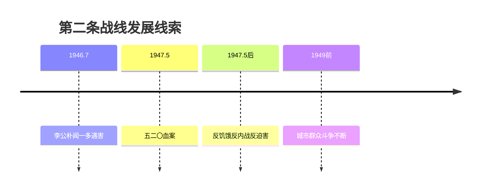

# 解放战争中配合军事斗争的第二条战线（人民民主运动）

## 第二条战线：国民党统治区的人民民主运动

抗战胜利后，国民党政府一面发动内战，一面在统治区加紧压迫。物价飞涨、特务横行、言论封锁，使城市学生与市民的不满迅速累积。**军事战场之外的群众斗争，逐渐形成配合解放军作战的“第二条战线”**。毛泽东在《蒋介石政府已处在全民的包围中》里指出，中国境内已有两条战线：第一条是蒋介石进犯军与人民解放军的战争，第二条是国民党统治区以学生运动为先导的人民民主运动。

> [!IMPORTANT]
> ==“第二条战线”不是军事战线之外的“第三条”==。毛泽东原文评价的是“第二条战线”。判断题若写成“第三条战线”，即为错误（答案：×）。

为什么会产生第二条战线？一个直接原因是**经济崩溃**。国民党统治区通货膨胀严重，物价一日数涨，货币急剧贬值。例如中央大学公费生的副食费标准远跟不上物价，1947 年学生们提出的直接诉求之一就是==提高副食费==，考试里对应的正确选项是 C。

> [!WARNING]
> 国统区通货膨胀、货币贬值的主要原因是国民党发动内战、军费浩大与官僚资本掠夺，**不是**当时国际社会的金融危机造成的。此题判断题答案为 ×。

1947 年 5 月 20 日，南京、上海、苏州、杭州等地学生在南京举行“反饥饿、反内战”游行请愿，遭到军警镇压，造成“五二〇”血案。此后学生运动口号进一步发展为：

==“反饥饿、反内战、反迫害”==

> [!TIP]
> 记三组词：饥饿（经济）、内战（政治）、迫害（人权）。与前期“反饥饿、反内战”相比，多了“反迫害”，对应血案之后觉悟与斗争升级。

学生的斗争不是孤立的。1946 年 7 月，民主人士李公朴、闻一多先后在昆明被特务暗杀。闻一多先生在==李公朴==殉难报告会上发表《最后一次的讲演》，痛斥反动派，当晚即遭枪杀。考试对应选项为 B（李公朴）。注意：李大钊牺牲于 1927 年奉系军阀统治时期，宋教仁遇刺于 1913 年，于再是“一二·一”运动烈士，均与本题无关。

南京曾是国民党统治中心，特务密布、监视严密，地下党组织反而面临极大危险。所谓“最危险的地方就是最安全的地方”是一种想当然的说法。

> [!CAUTION]
> 判断题：南京作为原国民政府首都，中共党组织处境**不是**比一般地区更加安全，而是极其危险。答案：×。

第二条战线的历史意义在于：它使国民党政府在军事失利之外，陷入政治孤立与经济动荡，动摇了其统治基础；同时也说明==人民群众的斗争是解放战争最终胜利的重要条件之一==。

> [!NOTE]
> 辨析“第一战场”与“第二战场”：前者是解放军与国民党军队的军事对抗；后者是国统区群众性民主运动，两者配合，形成全民包围蒋介石政府的局面。
